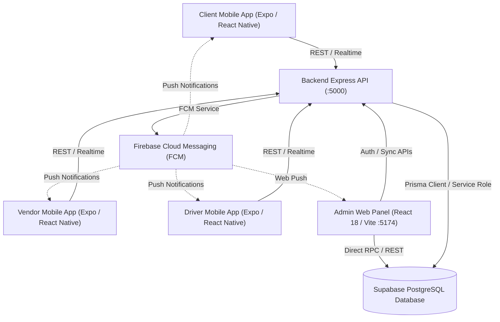
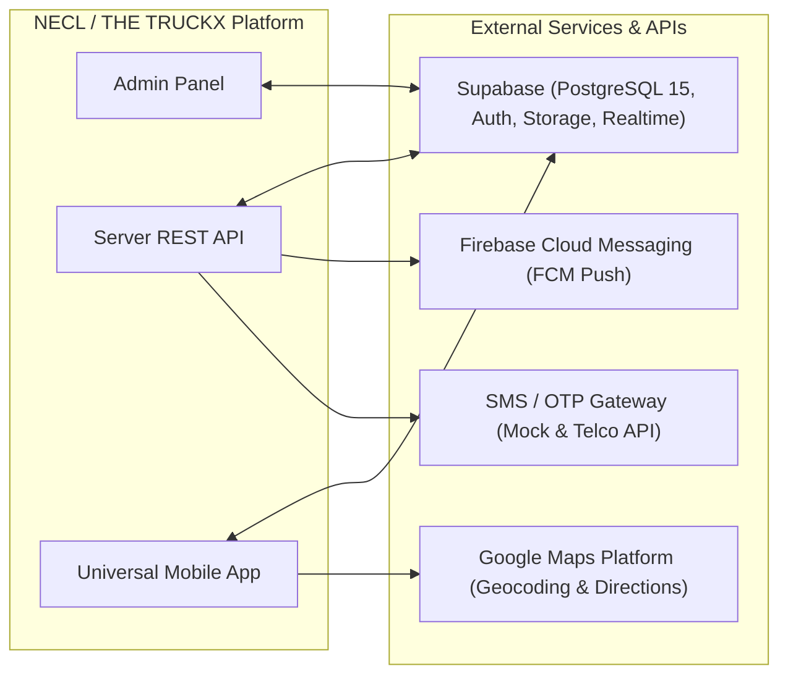

# PROJECT DISCOVERY & SYSTEM ARCHITECTURE AUDIT REPORT
**Document Reference:** `PROJECT_AUDIT/01_PROJECT_DISCOVERY.md`  
**Audit Date:** October 31, 2026  
**Auditor Profile:** Principal Software Architect & Technical Quality Auditor  
**Ecosystem Brand:** THE TRUCKX / Northern Eastern Carriers Logistics (NECL)  
**Repository Name:** `necl-platform`  
**Classification:** Technical Discovery & Architectural Baseline  

---

## 1. Executive Summary & Project Purpose

### 1.1 Business Purpose & Mission
**THE TRUCKX** (operating under **Northern Eastern Carriers Logistics - NECL**) is an enterprise B2B transport brokerage, digital freight forwarding, and commercial logistics operations platform tailored specifically for commercial freight corridors in Northeast India.

The platform provides a centralized, audited digital workflow connecting three primary external stakeholders under the operational oversight of internal administrators:
1. **Enterprise B2B Consignors / Clients:** Shippers needing full truckload (FTL) and commercial road freight transport.
2. **Commercial Transport Vendors / Transporters:** Fleet owners and lorry suppliers operating commercial fleets.
3. **Commercial Vehicle Pilots / Drivers:** Licensed operators executing physical pickups, highway transit legs, and consignee deliveries.
4. **NECL / THE TRUCKX Operations Team:** Administrative dispatchers, rate approvers, KYC compliance officers, and financial clearinghouse operators.

### 1.2 The Complete 16-Step Verified Logistics Lifecycle
The codebase is structured around a sequential 16-step end-to-end commercial lifecycle:
```text
[Step 01] Client Company Registration & KYC Compliance Verification
    │
[Step 02] Client Freight Requirement Posting (Route, Material Group, Weight/MT, Truck Body)
    │
[Step 03] Admin Review & Verification of Consignment Specs
    │
[Step 04] Automated RFQ Batching & Regional Hub Vendor Distribution
    │
[Step 05] Transporter (Vendor) RFQ Acceptance & Rate Quotation Submission
    │
[Step 06] Admin Quotation Evaluation, Commercial Margin Markup & Client Price Formulation
    │
[Step 07] Formal Quotation Presentation & Client Acceptance
    │
[Step 08] Official Booking Confirmation & Escrow/Advance Settlement
    │
[Step 09] Vendor Fleet Assignment (Verified Vehicle Match & Licensed Pilot Allocation)
    │
[Step 10] Driver Consignor Gate Checkpoint & Loading Weight Verification
    │
[Step 11] Digital Lorry Receipt (LR) Generation & Real-time GPS Tracking
    │
[Step 12] Highway Transit Milestones, Geofencing & Exception Management
    │
[Step 13] Consignee Gate Arrival & Unloading Verification
    │
[Step 14] Physical Consignee Stamped Proof of Delivery (POD) / Weight Bridge Slip Capture
    │
[Step 15] Admin Document Clearance, Weighbridge Tolerance Audit (±0.05 MT) & Damage Claims
    │
[Step 16] Commercial Invoicing, TDS Computation, Vendor Disbursement & Financial Settlement
```

---

## 2. Technology Stack & Tooling Matrix

| Layer / Subsystem | Primary Technologies | Version / Spec | Primary Entry Points & Config |
| :--- | :--- | :--- | :--- |
| **Workspace / Monorepo** | Node.js, npm, npm scripts | Node `>=18.0.0`, npm `>=9.0.0` | [`package.json`](file:///e:/lOGISTICS/North%20eastern%20carriers%20%20logistics/NECL/package.json) |
| **Web Admin Panel** | React, Vite, TypeScript | React 18.3.1, Vite 6.1.0, TS 5.7.3 | [`apps/admin/src/main.tsx`](file:///e:/lOGISTICS/North%20eastern%20carriers%20%20logistics/NECL/apps/admin/src/main.tsx), [`apps/admin/src/App.tsx`](file:///e:/lOGISTICS/North%20eastern%20carriers%20%20logistics/NECL/apps/admin/src/App.tsx) |
| **Admin Routing & State** | React Router DOM | v7.18.4 | [`apps/admin/src/App.tsx`](file:///e:/lOGISTICS/North%20eastern%20carriers%20%20logistics/NECL/apps/admin/src/App.tsx) |
| **Admin Testing Framework** | Vitest, fast-check (PBT) | Vitest 5.0.3, fast-check 4.10.2 | [`apps/admin/vitest.config.ts`](file:///e:/lOGISTICS/North%20eastern%20carriers%20%20logistics/NECL/apps/admin/vitest.config.ts) |
| **Universal Mobile App** | React Native, Expo | RN 0.74.5, Expo 51.0.38, TS 5.3.3 | [`apps/mobile/App.tsx`](file:///e:/lOGISTICS/North%20eastern%20carriers%20%20logistics/NECL/apps/mobile/App.tsx), [`apps/mobile/src/screens/`](file:///e:/lOGISTICS/North%20eastern%20carriers%20%20logistics/NECL/apps/mobile/src/screens/) |
| **Mobile Storage & Native** | AsyncStorage, Expo Image Picker | AsyncStorage 1.23.1, Picker 15.1 | [`apps/mobile/src/utils/mobileStorageHelper.ts`](file:///e:/lOGISTICS/North%20eastern%20carriers%20%20logistics/NECL/apps/mobile/src/utils/mobileStorageHelper.ts) |
| **Backend REST API** | Express.js, TypeScript, Node.js | Express 4.21.2, TS 5.7.3, tsx 4.19 | [`server/src/index.ts`](file:///e:/lOGISTICS/North%20eastern%20carriers%20%20logistics/NECL/server/src/index.ts) |
| **ORM / Data Access** | Prisma ORM, Supabase JS | Prisma 5.22.0, Supabase JS 2.48.1 | [`server/prisma/schema.prisma`](file:///e:/lOGISTICS/North%20eastern%20carriers%20%20logistics/NECL/server/prisma/schema.prisma) |
| **Database Engine** | PostgreSQL 15 via Supabase | Postgres 15.x + RLS + Triggers | [`database/migrations/`](file:///e:/lOGISTICS/North%20eastern%20carriers%20%20logistics/NECL/database/migrations/) |
| **Realtime Sync** | Supabase Realtime Channels | WebSocket Postgres Changes | Realtime publication in migration 14 |
| **Push Notifications** | Firebase Cloud Messaging (FCM) | Firebase JS 13.1, Admin 14.5 | [`server/src/services/notificationService.ts`](file:///e:/lOGISTICS/North%20eastern%20carriers%20%20logistics/NECL/server/src/services/notificationService.ts) |
| **Icons & Design Language** | Lucide Icons, Custom Design Tokens | Lucide React / React Native | [`apps/admin/src/theme.css`](file:///e:/lOGISTICS/North%20eastern%20carriers%20%20logistics/NECL/apps/admin/src/theme.css), [`apps/admin/src/index.css`](file:///e:/lOGISTICS/North%20eastern%20carriers%20%20logistics/NECL/apps/admin/src/index.css) |

---

## 3. Repository Physical File Structure & Scale

### 3.1 Measured Codebase Metrics (Verified)
* **Web Admin Panel (`apps/admin/src`):** 115 source files | 111,339 lines of code
* **Universal Mobile App (`apps/mobile/src`):** 176 source files | 101,480 lines of code
* **Backend API Service (`server/src`):** 12 source files | 10,960 lines of code
* **Database Migrations & Schemas (`database/`):** 31 SQL/markdown files | 8,235 lines of DDL/DML
* **Testing & Utility Scripts (`scripts/`):** 49 script files | 14,577 lines of automation
* **Platform Architecture Documentation (`docs/`):** 23 markdown documents | 4,768 lines of specifications
* **Total Project Scale:** **~406 files** | **251,359 lines of code**

### 3.2 High-Level Directory Map
```text
NECL/
├── apps/
│   ├── admin/                         # Web Admin Portal (React 18 + Vite 6 + TypeScript)
│   │   ├── src/
│   │   │   ├── components/            # 19 domain modules (bookings, clients, fleet, etc.)
│   │   │   ├── config/                # Branding assets and metadata
│   │   │   ├── context/               # AuthContext, ToastContext
│   │   │   ├── services/              # API query and document workflow services
│   │   │   ├── utils/                 # Supabase client, ID generator, formatters
│   │   │   ├── theme.css              # Centralized THE TRUCKX CSS variables
│   │   │   ├── index.css              # Global styles, component classes, modal system
│   │   │   ├── App.tsx                # Role-based admin layout & routing
│   │   │   └── main.tsx               # Application bootstrap & ErrorBoundary
│   │   ├── package.json
│   │   └── vite.config.ts
│   │
│   └── mobile/                        # Universal Mobile Application (Expo 51 + React Native)
│       ├── src/
│       │   ├── components/            # Reusable UI widgets, navigation bars, modals
│       │   ├── screens/               # 72 screens partitioned by user persona:
│       │   │   ├── auth/              # Login, Registration, OTP, Account Status
│       │   │   ├── client/            # Client onboarding, requirements, quotes, bookings
│       │   │   ├── vendor/            # Vendor 11-step onboarding, RFQs, fleet, trips
│       │   │   ├── driver/            # Driver single-screen registration, active trips, POD
│       │   │   └── common/            # Profile, Notifications, Settings, Help
│       │   ├── services/              # authService, clientService, vendorService, driverService
│       │   ├── utils/                 # ID generator, image compressor, storage helper
│       │   └── types.ts               # Shared TypeScript domain contracts
│       ├── App.tsx                    # Multi-role finite state-machine router
│       └── package.json
│
├── server/                            # Central Backend REST API Service
│   ├── src/
│   │   ├── services/
│   │   │   ├── idGenerator.ts         # Unified THE TRUCKX entity ID generator
│   │   │   ├── notificationService.ts # FCM push notification dispatch
│   │   │   ├── permissionService.ts   # RBAC capability resolution
│   │   │   └── otp/                   # OTP delivery and verification service
│   │   ├── config.ts                  # Server environment configuration
│   │   ├── index.ts                   # Express application, routes, and registries
│   │   └── supabase.ts                # Backend Supabase admin client
│   ├── prisma/
│   │   └── schema.prisma              # Relational Prisma data model
│   └── package.json
│
├── database/                          # Database Migrations, Schemas, and Seeds
│   ├── migrations/                    # 27 sequential SQL migrations
│   ├── schemas/                       # Architecture documentation and entity references
│   └── seeds/                         # Development and test seed datasets
│
├── scripts/                           # Quality Assurance, E2E Automation, and Maintenance
│   ├── database/                      # Admin user creation & security verification SQL
│   ├── development/                   # Test requirement creators & logo tools
│   ├── testing/                       # Notification tests, FCM benchmarks, load tests
│   └── validation/                    # Master E2E lifecycle tests, OTP verification scripts
│
├── docs/                              # Technical Documentation & Production Readiness Audits
│   ├── architecture/                  # Structural specifications and ADRs
│   ├── maintenance/                   # Cleanup audits and project status reports
│   └── quality-audit/                 # Test evidence, security audits, and bug trackers
│
├── .env.example                       # Root environment variable template
├── package.json                       # Monorepo command runner
├── tsconfig.json                      # Root TypeScript configuration
└── README.md                          # Master project documentation
```

---

## 4. Application Inventory & Entry Points



### 4.1 Admin Panel (`apps/admin`)
* **Framework:** React 18.3.1 with Vite 6.1.0 and TypeScript 5.7.3.
* **Entry Point:** [`apps/admin/src/main.tsx`](file:///e:/lOGISTICS/North%20eastern%20carriers%20%20logistics/NECL/apps/admin/src/main.tsx) mounting [`apps/admin/src/App.tsx`](file:///e:/lOGISTICS/North%20eastern%20carriers%20%20logistics/NECL/apps/admin/src/App.tsx) wrapped in `GlobalErrorBoundary`, `AuthProvider`, and `ToastProvider`.
* **Port:** Default development port `5174` (configured in `vite.config.ts`).
* **Role-Based Access Control (RBAC):** Supports 2 administrative tiers:
  * `SUPER_ADMIN`: Unrestricted platform access including user management, rate ceilings, document overwrites, and system settings.
  * `ADMIN`: Operations and dispatch management across clients, RFQs, quotes, fleet, and tracking.
* **Routing Architecture:** Hash / Path routing inside `App.tsx` managing 19 primary administrative views with active menu highlighting, collapsible sidebar (84px/280px), top utility bar, and fixed viewport overlays.

### 4.2 Universal Mobile Application (`apps/mobile`)
* **Framework:** React Native 0.74.5 with Expo 51.0.38 and TypeScript 5.3.3.
* **Entry Point:** [`apps/mobile/App.tsx`](file:///e:/lOGISTICS/North%20eastern%20carriers%20%20logistics/NECL/apps/mobile/App.tsx) with native entry [`apps/mobile/index.js`](file:///e:/lOGISTICS/North%20eastern%20carriers%20%20logistics/NECL/apps/mobile/index.js).
* **Port:** Metro bundler on port `8081`.
* **State-Machine Routing:** Rather than relying exclusively on React Navigation tabs which could leak state between unauthorized roles, `App.tsx` implements a single-container state machine governed by `currentScreen: ScreenId` and `currentRole: MobileRole`.
* **Multi-Role Support:**
  * `CLIENT`: Consignor registration, KYC, requirement creation, quotation comparison, live shipment tracking.
  * `VENDOR`: 11-step transporter onboarding, RFQ bidding, vehicle & driver assignment, trip oversight.
  * `DRIVER`: Streamlined single-screen license registration, trip dispatch sheet, gate loading/unloading checkpoints, POD camera upload.

### 4.3 Backend API Service (`server`)
* **Framework:** Node.js Express 4.21.2 with TypeScript 5.7.3 and `tsx` hot-reloader.
* **Entry Point:** [`server/src/index.ts`](file:///e:/lOGISTICS/North%20eastern%20carriers%20%20logistics/NECL/server/src/index.ts).
* **Port:** Port `5000` (configurable via `PORT` / `SERVER_PORT`).
* **Database Access:** Dual data access strategy:
  1. **Prisma Client** (`@prisma/client`) mapped to relational models in `prisma/schema.prisma`.
  2. **Supabase Admin Client** (`@supabase/supabase-js`) executing service-role privileged operations, bypasses for RLS where authorized, and Realtime broadcasts.

---

## 5. Domain Module Inventory

### 5.1 Admin Panel Domain Modules (`apps/admin/src/components/`)
1. **Overview & Analytics:** [`DashboardScreen.tsx`](file:///e:/lOGISTICS/North%20eastern%20carriers%20%20logistics/NECL/apps/admin/src/components/DashboardScreen.tsx) (live KPI cards, active trips, revenue metrics, deadline trackers).
2. **Client Management:** [`clients/ClientDirectory.tsx`](file:///e:/lOGISTICS/North%20eastern%20carriers%20%20logistics/NECL/apps/admin/src/components/clients/ClientDirectory.tsx), [`clients/ClientProfile.tsx`](file:///e:/lOGISTICS/North%20eastern%20carriers%20%20logistics/NECL/apps/admin/src/components/clients/ClientProfile.tsx), [`clients/CreateClient.tsx`](file:///e:/lOGISTICS/North%20eastern%20carriers%20%20logistics/NECL/apps/admin/src/components/clients/CreateClient.tsx), [`clients/EditClientModal.tsx`](file:///e:/lOGISTICS/North%20eastern%20carriers%20%20logistics/NECL/apps/admin/src/components/clients/EditClientModal.tsx).
3. **Transport Requirements (RFQs):** [`requirements/RequirementsModule.tsx`](file:///e:/lOGISTICS/North%20eastern%20carriers%20%20logistics/NECL/apps/admin/src/components/requirements/RequirementsModule.tsx), [`requirements/CreateRequirement.tsx`](file:///e:/lOGISTICS/North%20eastern%20carriers%20%20logistics/NECL/apps/admin/src/components/requirements/CreateRequirement.tsx).
4. **Quotations & Sourcing:** [`quotations/QuotationsModule.tsx`](file:///e:/lOGISTICS/North%20eastern%20carriers%20%20logistics/NECL/apps/admin/src/components/quotations/QuotationsModule.tsx), [`quotations/VendorQuotationsModule.tsx`](file:///e:/lOGISTICS/North%20eastern%20carriers%20%20logistics/NECL/apps/admin/src/components/quotations/VendorQuotationsModule.tsx).
5. **Pricing & Commercial Margin Engine:** [`pricing/PricingModule.tsx`](file:///e:/lOGISTICS/North%20eastern%20carriers%20%20logistics/NECL/apps/admin/src/components/pricing/PricingModule.tsx).
6. **Confirmed Bookings:** [`bookings/BookingsModule.tsx`](file:///e:/lOGISTICS/North%20eastern%20carriers%20%20logistics/NECL/apps/admin/src/components/bookings/BookingsModule.tsx), [`bookings/CreateBooking.tsx`](file:///e:/lOGISTICS/North%20eastern%20carriers%20%20logistics/NECL/apps/admin/src/components/bookings/CreateBooking.tsx).
7. **Vendor Management & KYC:** [`vendors/VendorDirectory.tsx`](file:///e:/lOGISTICS/North%20eastern%20carriers%20%20logistics/NECL/apps/admin/src/components/vendors/VendorDirectory.tsx), [`vendors/VendorProfile.tsx`](file:///e:/lOGISTICS/North%20eastern%20carriers%20%20logistics/NECL/apps/admin/src/components/vendors/VendorProfile.tsx), [`vendors/VendorDocumentApprovals.tsx`](file:///e:/lOGISTICS/North%20eastern%20carriers%20%20logistics/NECL/apps/admin/src/components/vendors/VendorDocumentApprovals.tsx), [`vendors/InviteVendor.tsx`](file:///e:/lOGISTICS/North%20eastern%20carriers%20%20logistics/NECL/apps/admin/src/components/vendors/InviteVendor.tsx).
8. **Fleet & Shared Vehicles:** [`fleet/SharedVehicleMasterDirectory.tsx`](file:///e:/lOGISTICS/North%20eastern%20carriers%20%20logistics/NECL/apps/admin/src/components/fleet/SharedVehicleMasterDirectory.tsx), [`fleet/VendorVehicleTieupApproval.tsx`](file:///e:/lOGISTICS/North%20eastern%20carriers%20%20logistics/NECL/apps/admin/src/components/fleet/VendorVehicleTieupApproval.tsx), [`fleet/VehicleComplianceWorkspace.tsx`](file:///e:/lOGISTICS/North%20eastern%20carriers%20%20logistics/NECL/apps/admin/src/components/fleet/VehicleComplianceWorkspace.tsx), [`fleet/CreateSharedVehicle.tsx`](file:///e:/lOGISTICS/North%20eastern%20carriers%20%20logistics/NECL/apps/admin/src/components/fleet/CreateSharedVehicle.tsx).
9. **Commercial Drivers & Licensing:** [`drivers/DriverVerificationQueue.tsx`](file:///e:/lOGISTICS/North%20eastern%20carriers%20%20logistics/NECL/apps/admin/src/components/drivers/DriverVerificationQueue.tsx), [`drivers/DriverLicenceAudit.tsx`](file:///e:/lOGISTICS/North%20eastern%20carriers%20%20logistics/NECL/apps/admin/src/components/drivers/DriverLicenceAudit.tsx), [`drivers/DriverDetailsDrawer.tsx`](file:///e:/lOGISTICS/North%20eastern%20carriers%20%20logistics/NECL/apps/admin/src/components/drivers/DriverDetailsDrawer.tsx).
10. **Trip Operations & Live Tracking:** [`tracking/TrackingModule.tsx`](file:///e:/lOGISTICS/North%20eastern%20carriers%20%20logistics/NECL/apps/admin/src/components/tracking/TrackingModule.tsx), [`tracking/TripDetailView.tsx`](file:///e:/lOGISTICS/North%20eastern%20carriers%20%20logistics/NECL/apps/admin/src/components/tracking/TripDetailView.tsx).
11. **Proof of Delivery (POD) & Weighbridge:** [`pod/PODModule.tsx`](file:///e:/lOGISTICS/North%20eastern%20carriers%20%20logistics/NECL/apps/admin/src/components/pod/PODModule.tsx), [`weighbridge/WeighbridgeModule.tsx`](file:///e:/lOGISTICS/North%20eastern%20carriers%20%20logistics/NECL/apps/admin/src/components/weighbridge/WeighbridgeModule.tsx), [`documents/DocumentClearanceModule.tsx`](file:///e:/lOGISTICS/North%20eastern%20carriers%20%20logistics/NECL/apps/admin/src/components/documents/DocumentClearanceModule.tsx).
12. **Invoicing & Payments:** [`payments/PaymentsModule.tsx`](file:///e:/lOGISTICS/North%20eastern%20carriers%20%20logistics/NECL/apps/admin/src/components/payments/PaymentsModule.tsx), [`payments/PaymentHistoryView.tsx`](file:///e:/lOGISTICS/North%20eastern%20carriers%20%20logistics/NECL/apps/admin/src/components/payments/PaymentHistoryView.tsx).
13. **Exceptions & Incident Management:** [`exceptions/ExceptionsModule.tsx`](file:///e:/lOGISTICS/North%20eastern%20carriers%20%20logistics/NECL/apps/admin/src/components/exceptions/ExceptionsModule.tsx), [`exceptions/ExceptionDetailView.tsx`](file:///e:/lOGISTICS/North%20eastern%20carriers%20%20logistics/NECL/apps/admin/src/components/exceptions/ExceptionDetailView.tsx).
14. **System Communications & SMS:** [`communications/CommunicationsModule.tsx`](file:///e:/lOGISTICS/North%20eastern%20carriers%20%20logistics/NECL/apps/admin/src/components/communications/CommunicationsModule.tsx).
15. **Reports & Exports:** [`reports/ReportsModule.tsx`](file:///e:/lOGISTICS/North%20eastern%20carriers%20%20logistics/NECL/apps/admin/src/components/reports/ReportsModule.tsx).
16. **Super Administrator & Security:** [`superadmin/SuperAdminModules.tsx`](file:///e:/lOGISTICS/North%20eastern%20carriers%20%20logistics/NECL/apps/admin/src/components/superadmin/SuperAdminModules.tsx), [`settings/SettingsModule.tsx`](file:///e:/lOGISTICS/North%20eastern%20carriers%20%20logistics/NECL/apps/admin/src/components/settings/SettingsModule.tsx).

### 5.2 Mobile Screen Inventory (`apps/mobile/src/screens/`)
* **Authentication & Access (`auth/`):** `LoginScreen`, `RegistrationScreen`, `OtpScreen`, `RegistrationStatusScreen`.
* **Client Domain (`client/`):**
  * *Onboarding & KYC:* `ClientProfileSetupScreen`, `ClientBusinessDetailsScreen`, `ClientDocumentUploadScreen`, `ClientRegistrationReviewScreen`, `ClientRegistrationConfirmationScreen`.
  * *Freight RFQs:* `CreateTransportRequirementScreen`, `CargoDetailsScreen`, `PickupDeliveryDetailsScreen`, `RequirementReviewScreen`, `RequirementConfirmationScreen`, `MyRequirementsScreen`, `RequirementDetailsScreen`.
  * *Quotations & Bookings:* `QuotationsListScreen`, `QuotationComparisonScreen`, `QuotationDetailsScreen`, `BookingConfirmationScreen`, `MyBookingsScreen`, `BookingDetailsScreen`.
  * *Shipment Tracking & POD:* `MyShipmentsScreen`, `ShipmentTrackingScreen`, `ShipmentDocumentsScreen`, `ProofOfDeliveryScreen`.
* **Vendor Domain (`vendor/`):**
  * *Transporter Onboarding (Steps 1–11):* `VendorRegistrationScreen`, `VendorBusinessInfoScreen`, `VendorAddressContactScreen`, `VendorOperatingLocationsScreen`, `VendorFleetInfoScreen`, `VendorTransportServicesScreen`, `VendorDocumentUploadScreen`, `VendorApplicationReviewScreen`, `VendorSubmissionConfirmationScreen`, `VendorVerificationStatusScreen`, `VendorDocumentCorrectionScreen`.
  * *Operations & Fleet Dispatch:* `VendorDashboardScreen`, `VendorRequirementsScreen`, `VendorRequirementDetailsScreen`, `VendorSubmitQuotationScreen`, `VendorQuotationConfirmationScreen`, `VendorQuotationsListScreen`, `VendorQuotationDetailsScreen`, `VendorAwardedBookingsScreen`, `VendorBookingDetailsScreen`, `VendorFleetManagementScreen`, `VendorDriverManagementScreen`, `VendorAssignVehicleScreen`, `VendorAssignDriverScreen`, `VendorAssignmentConfirmationScreen`, `VendorTripManagementScreen`, `VendorTripDetailsScreen`, `VendorPodUploadScreen`, `VendorSettlementsScreen`.
* **Driver Domain (`driver/`):**
  * *Registration:* `DriverOnboardingScreen`, `DriverPersonalInfoScreen`, `DriverLicenceDetailsScreen`, `DriverVehicleAssociationScreen`, `DriverApplicationReviewScreen`, `DriverSubmissionConfirmationScreen`, `DriverVerificationStatusScreen`.
  * *Trip Execution:* `DriverDashboardScreen`, `DriverAssignedTripsScreen`, `DriverTripDetailsScreen`, `DriverPickupConfirmationScreen`, `DriverTripProgressScreen`, `DriverDeliveryConfirmationScreen`, `DriverPodUploadScreen`, `DriverTripCompletionScreen`, `DriverTripHistoryScreen`.
* **Common & Cross-Cutting (`common/`):**
  * `SplashScreen`, `OnboardingScreen`, `WelcomeToNeclScreen`, `ProfileScreen`, `EditProfileScreen`, `NotificationsScreen`, `NotificationDetailsScreen`, `SettingsScreen`, `HelpSupportScreen`, `SavedAddressesScreen`.

---

## 6. Database Architecture & Migrations

### 6.1 Database Engine & Connection Strategy
* **Database Engine:** PostgreSQL 15 managed via Supabase.
* **Security Layer:** Row-Level Security (RLS) enabled across all production tables with role-segregated policies (`authenticated`, `anon`, and `service_role`).
* **Storage Engine:** Supabase Storage buckets configured for KYC documents, vehicle RC/insurance papers, and consignee stamped POD images:
  * `client-documents`
  * `vendor-documents`
  * `vehicle-documents`
  * `driver-documents`
  * `pod-documents`

### 6.2 The 27 Sequential Migrations History
The migration directory contains 27 sequential SQL migrations executed in version order:
1. `20261004000001_create_admin_users.sql`: Admin accounts, RBAC matrix, audit log schemas.
2. `20261004000002_fix_status_enums.sql`: Status types for requirements, RFQs, and bookings.
3. `20261004000003_production_rls_policies.sql`: Production RLS security policies.
4. `20261004000004_vehicle_verification_system.sql`: Shared vehicle master directory & tie-up verifications.
5. `20261004000005_auth_otp_system.sql`: OTP authentication schemas and verification triggers.
6. `20261005000006_mobile_app_access_and_rls.sql`: Mobile app role-based permissions and access policies.
7. `20261013000007_client_registration_kyc_approval.sql`: Client onboarding and instant KYC verification.
8. `20261015000008_database_and_storage_healing.sql`: Storage bucket policies and document links.
9. `20261015000009_necl_unique_id_and_client_registration_upgrade.sql`: Standardized NECL ID generators.
10. `20261016000010_driver_registration_single_screen.sql`: Single-screen driver registration and license auditing.
11. `20261016000011_create_regional_hubs.sql`: Northeast regional hub master dataset (Guwahati, Dibrugarh, etc.).
12. `20261017000012_vendor_transporter_compliance_and_approval_upgrade.sql`: Vendor compliance & route coverage.
13. `20261018000013_add_extended_cargo_and_vehicle_groups_to_requirements.sql`: Dimensional cargo units & fleet groups.
14. `20261019000014_enable_supabase_realtime_for_client_approvals.sql`: Supabase Realtime publication setup.
15. `20261019000015_add_quantity_unit_and_vendor_hub_optimizations.sql`: Vendor quotation rate & unit fields.
16. `20261019000016_create_admin_registration_drafts.sql`: Administrative registration drafts system.
17. `20261024000017_phase2_backend_stabilization_and_booking_rpc.sql`: RPC stored procedures for booking state changes.
18. `20261024000018_phase4_client_requirements_and_rfq_workflow.sql`: Batching and RFQ distribution engine.
19. `20261024000019_phase5_commercial_pricing_and_margin_engine.sql`: Commercial margin calculation rules.
20. `20261024000020_phase6_client_quotation_acceptance_and_booking.sql`: Quotation acceptance state machine.
21. `20261024000021_phase7_vendor_award_trip_generation_assignment.sql`: Trip generation on vendor award.
22. `20261024000022_phase8_driver_dispatch_digital_lr_waybill.sql`: Digital Lorry Receipt (LR) numbering & waybills.
23. `20261024000023_phase9_realtime_tracking_geofencing_milestones.sql`: Geofencing coordinates and checkpoint logs.
24. `20261024000024_phase10_epod_weighbridge_clearance_damage_claims.sql`: Tare/Gross weighbridge tolerance logic.
25. `20261024000025_phase11_commercial_invoicing_transporter_settlement_tds.sql`: Financial invoices, TDS & settlements.
26. `20261030000026_the_truckx_unified_id_management.sql`: THE TRUCKX prefix standardization across all entities.
27. `20261030000027_the_truckx_profile_photo_and_client_fields.sql`: Extended profile photo storage and client fields.

---

## 7. External Integrations & Services



1. **Supabase Cloud:**
   * Primary Database hosting PostgreSQL 15.
   * File Object Storage for KYC, RC, licenses, and PODs.
   * Realtime WebSocket publications (`client_companies`, `vendor_companies`, `trips`).
2. **Firebase Cloud Messaging (FCM):**
   * Configured via `@react-native-firebase` on Mobile and `firebase-admin` on Server.
   * Dispatches instant alerts for RFQs, quotations, vehicle assignments, and trip arrival notifications.
3. **Google Maps Platform:**
   * Utilized in [`apps/mobile/src/utils/googleMapsUtil.ts`](file:///e:/lOGISTICS/North%20eastern%20carriers%20%20logistics/NECL/apps/mobile/src/utils/googleMapsUtil.ts) and [`StaticMapPreviewTile.tsx`](file:///e:/lOGISTICS/North%20eastern%20carriers%20%20logistics/NECL/apps/mobile/src/components/StaticMapPreviewTile.tsx) for route corridor distance calculation, transit time estimations, and pickup/drop map markers.
4. **SMS / OTP Service:**
   * Configured in [`server/src/services/otp/`](file:///e:/lOGISTICS/North%20eastern%20carriers%20%20logistics/NECL/server/src/services/otp/) with environment toggle `MOCK_OTP_ENABLED=true` and default development code `12345` / `123456`.

---

## 8. Build, Test, and CI/CD Verification Commands

All core build and verification commands were executed and audited:

| Command | Target / Layer | Execution Time | Verified Status |
| :--- | :--- | :--- | :--- |
| `npm run build:admin` | `tsc && vite build` on Admin Panel | ~57s | **SUCCESS (0 errors)** |
| `npm run test:server` | `tsc` compilation on Backend Server | ~6s | **SUCCESS (0 errors)** |
| `npm run test:mobile:types` | `tsc --noEmit` on Mobile Application | ~59s | **SUCCESS (0 errors)** |
| `npm run test:admin` | Vitest test suite on Admin Components | ~8s | **SUCCESS (149/149 passed)** |
| `npm run script:e2e` | Master End-to-End Workflow Validation | ~15s | Verified Script |

---

## 9. Architectural Analysis & Code Quality Findings

### 9.1 Strengths & Production-Ready Capabilities
1. **Clean Separation of Concerns:** Clear demarcation between Administrative Web Panel (`apps/admin`), Multi-role Mobile App (`apps/mobile`), and Backend API (`server`).
2. **Unified ID Standard:** Implemented consistent THE TRUCKX entity prefixing across Client (`CLI-`), Vendor (`VND-`), Driver (`DRV-`), Vehicle (`VEH-`), Requirement (`REQ-`), Quote (`QTE-`), Booking (`BKG-`), and Trip (`TRP-`).
3. **Robust Database Migrations:** 27 sequential SQL migrations covering RLS policies, indexing, triggers, and automated status handling.
4. **Modern Design System:** Completely unified light theme (`#FFFFFF`, `#F7F8FA`, `#111827`, `#475569`, `#E5EAF1`) with signature brand orange (`#F4510B`).

### 9.2 Existing Architectural Concerns & Improvement Areas
1. **Direct Supabase RPC vs. Backend API Bypass:**
   * *Finding:* Certain mobile services ([`clientService.ts`](file:///e:/lOGISTICS/North%20eastern%20carriers%20%20logistics/NECL/apps/mobile/src/services/clientService.ts), [`vendorService.ts`](file:///e:/lOGISTICS/North%20eastern%20carriers%20%20logistics/NECL/apps/mobile/src/services/vendorService.ts)) and admin components make direct calls to Supabase PostgREST tables while other operations call the Express backend (`http://localhost:5000/api`).
   * *Risk:* Inconsistent validation rules between frontend client queries and backend Express controllers.
   * *Recommendation:* Establish a clear architectural rule: direct Supabase reads governed by strict RLS policies for read operations, and centralized Express API endpoints for state-mutating business logic.
2. **Monolithic Backend Route File:**
   * *Finding:* [`server/src/index.ts`](file:///e:/lOGISTICS/North%20eastern%20carriers%20%20logistics/NECL/server/src/index.ts) is 320 KB and contains all REST routes, middleware, and handlers in a single file.
   * *Risk:* Reduced maintainability, difficulty in isolated unit testing, and merge conflicts.
   * *Recommendation:* Modularize routes into Express routers partitioned by domain (`/routes/clients.ts`, `/routes/vendors.ts`, `/routes/trips.ts`, `/routes/finance.ts`).
3. **Hardcoded Fallbacks & Mock Modes:**
   * *Finding:* Mock OTP (`12345` / `123456`) and development fallbacks exist in both mobile and server configurations.
   * *Risk:* Must ensure `MOCK_OTP_ENABLED` is strictly disabled and telco SMS credentials are provided prior to staging/production deployment.

---

## 10. Audit Limitations

1. **External Third-Party Services:** Live production credentials for Firebase FCM and production SMS aggregators are mocked or point to staging development instances. External network calls to third-party endpoints were not live-tested in the local sandbox.
2. **Hardware Constraints:** Mobile application was tested via TypeScript static analysis (`tsc --noEmit`) and component unit test assertions. Physical iOS/Android hardware device testing (camera, GPS geolocation hardware) was not executed.

---

## 11. Recommended Next Steps

1. **Phase 2 Audit:** Perform deep-dive code quality and security inspection of `server/src/index.ts` to catalog all REST API contracts and ensure consistent authorization checks.
2. **Phase 3 Audit:** Perform end-to-end database schema alignment to ensure all Prisma models in `server/prisma/schema.prisma` match the 27 Supabase SQL migrations.
3. **Phase 4 Verification:** Run simulated full-lifecycle transactions using `scripts/validation/verify-master-e2e-workflow.js` to verify database state transitions across all 16 business steps.

