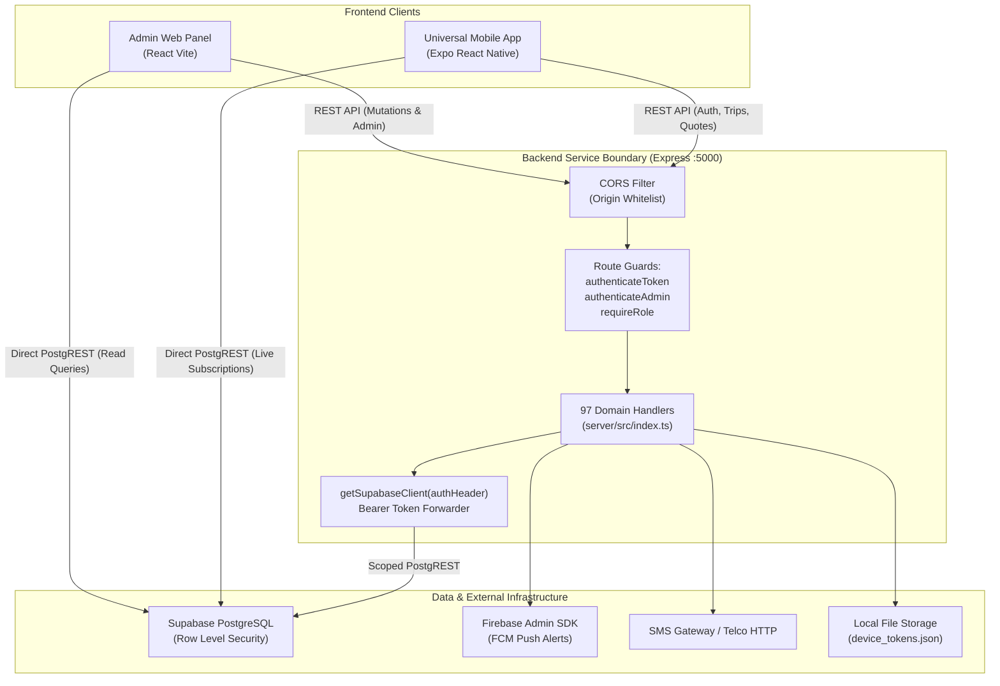
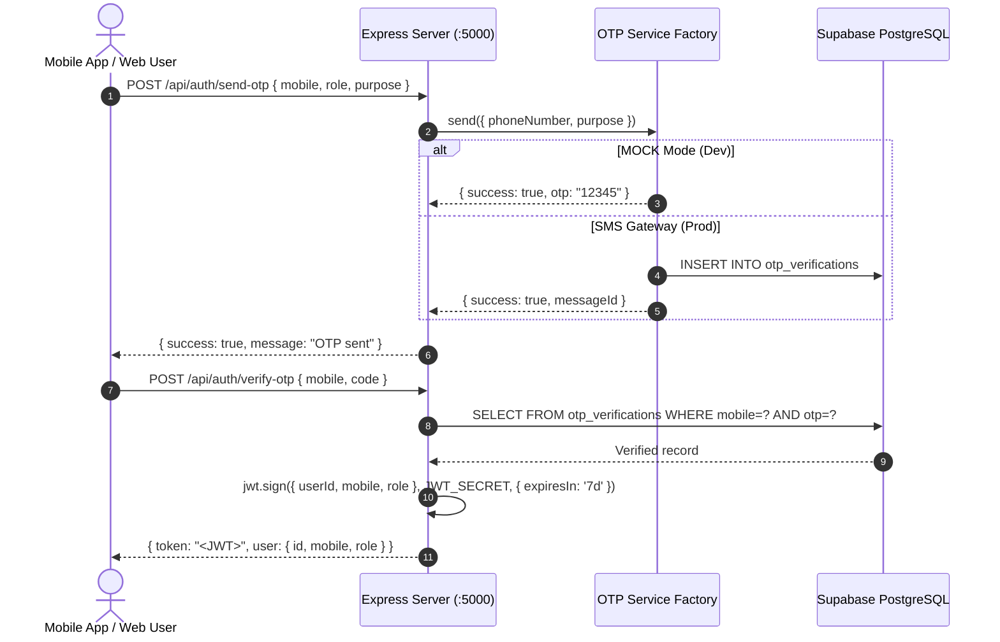
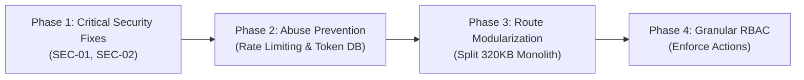

# THE TRUCKX / NECL — REST API & Security Architecture Audit

**Document Reference:** `PROJECT_AUDIT/02_API_AND_SECURITY_AUDIT.md`  
**Audit Conducted:** October 31, 2026  
**Auditor:** Principal Software Architect & Technical Security Auditor  
**Scope:** Backend Express Service (`server/src`), Authentication Engine, RBAC Matrix, Security Boundaries, Database Access Patterns  
**Status:** **AUDIT COMPLETED — ACTION REQUIRED ON 3 CRITICAL VULNERABILITIES**

---

## 1. Executive Summary & Audit Scope

A comprehensive security, architectural, and data-contract audit was conducted across the backend service layer of the NECL / THE TRUCKX platform (`server/src`). The backend is an Express 4.21 TypeScript application comprising **97 REST API endpoints** implemented in a single monolithic controller file ([`server/src/index.ts`](file:///e:/lOGISTICS/North%20eastern%20carriers%20%20logistics/NECL/server/src/index.ts), 9,087 lines of code, ~320 KB).

### Summary of Audit Findings

| Metric / Dimension | Verified Finding | Risk Level |
| :--- | :--- | :--- |
| **Total REST Endpoints** | **97 Endpoints** across 13 functional logistics domains | Informational |
| **Route Middleware Protection** | **23 of 97** endpoints enforce explicit Express route middleware (`authenticateToken` or `authenticateAdmin`) | **CRITICAL** |
| **Client RLS Delegation Fallback** | Unauthenticated requests to certain mutating endpoints fall back to the root `supabase` service role | **CRITICAL** |
| **Default Secret Hardcoding** | Hardcoded JWT fallback secret and default development admin credentials present in source code | **CRITICAL** |
| **OTP Architecture** | Tri-mode OTP engine (Mock, FCM, SMS Gateway) with in-memory / Supabase logging | High |
| **Rate Limiting & Anti-Abuse** | No request rate-limiting middleware configured on OTP generation or public registration endpoints | High |
| **In-Memory & File-Based State** | Push tokens stored in local JSON file; invoice idempotency stored in runtime `Map` | Medium |
| **ORM vs Driver Discrepancy** | Prisma 5.22 installed and configured in `schema.prisma`, but entirely unused in backend code | Informational |

---

## 2. API Communication Architecture

The NECL / THE TRUCKX platform utilizes a hybrid backend communication model:



### 2.1 The Dual-Access Dilemma (Bifurcated Data Layer)
1. **Direct PostgREST Access:** Frontend applications (`apps/admin` and `apps/mobile`) instantiate direct `@supabase/supabase-js` clients for reactive data subscriptions, document uploads, and table reads.
2. **Express Backend API:** Frontend clients invoke `http://localhost:5000/api` for multi-table transactions, sequential ID creation (`TRUCKX-*`), payment ledger reconciliation, OTP generation, and driver/vendor verification reviews.
3. **Architectural Gap:** Because business logic is divided between PostgreSQL triggers/RLS policies and Express route handlers, discrepancies can emerge if a client bypasses the backend and mutates tables directly via Supabase PostgREST.

---

## 3. Complete REST API Catalog (97 Endpoints)

### 3.1 Authentication & Session Management (8 Endpoints)

| Method | Endpoint Path | Middleware Guard | Target Role | Database Mutation / Target Table | Validation Status |
| :--- | :--- | :--- | :--- | :--- | :--- |
| `POST` | `/api/auth/admin-login` | None (Public) | Public / Admin | Authenticates via `admin_users` or Supabase Auth | Validates email/password/otp |
| `POST` | `/api/auth/check-registration` | None (Public) | Public | Reads `client_users`, `vendor_users`, `drivers` | Checks mobile existence |
| `POST` | `/api/auth/register-sync` | None (Public) | Public | Inserts into respective user/company tables | Verifies payload fields |
| `POST` | `/api/auth/send-otp` | None (Public) | Public | Inserts into `otp_verifications` | Enforces 10-digit phone regex |
| `POST` | `/api/auth/verify-otp` | None (Public) | Public | Updates `otp_verifications`, generates JWT | Verifies OTP code & expiry |
| `GET` | `/api/auth/registration-status` | None (Public) | Public | Reads user status across roles | Query param `mobile` |
| `GET` | `/api/health` | None (Public) | Public | System probe (timestamp, uptime) | None |
| `GET` | `/api/auth/me` | `authenticateToken` | Authenticated | Reads decoded token payload & profile | Token verified |

### 3.2 Client Onboarding & Review (6 Endpoints)

| Method | Endpoint Path | Middleware Guard | Target Role | Database Mutation / Target Table | Validation Status |
| :--- | :--- | :--- | :--- | :--- | :--- |
| `POST` | `/api/client/submit-registration` | None | Public / Client | Inserts `client_companies`, `client_users`, `client_kyc` | Validates GSTIN, PAN, Phone |
| `GET` | `/api/client/status/:identifier` | None | Public / Client | Reads `client_companies` by ID or Mobile | Identifier parameter |
| `POST` | `/api/auth/admin-review-client` | `authenticateAdmin` | ADMIN, SUPER_ADMIN | Updates `client_companies.status` | Validates status enum |
| `POST` | `/api/client/admin-review` | `authenticateAdmin` | ADMIN, SUPER_ADMIN | Alias to `handleAdminClientReview` | Validates status enum |
| `GET` | `/api/clients/:id` | None | Any / Scoped | Reads client company & KYC records | Header token passed |
| `PUT` | `/api/clients/:id` | None | Any / Scoped | Updates client details | Header token passed |

### 3.3 Regional Hubs & Logistics Infrastructure (4 Endpoints)

| Method | Endpoint Path | Middleware Guard | Target Role | Database Mutation / Target Table | Validation Status |
| :--- | :--- | :--- | :--- | :--- | :--- |
| `GET` | `/api/regional-hubs` | None (Cached) | Public / All | Reads `regional_hubs` (60s memory cache) | None |
| `POST` | `/api/regional-hubs` | None | Admin | Inserts into `regional_hubs` | Validates hub name, city, state |
| `PUT` | `/api/regional-hubs/:id` | None | Admin | Updates `regional_hubs` | Validates ID and fields |
| `DELETE` | `/api/regional-hubs/:id` | None | Admin | Deletes from `regional_hubs` | Validates ID parameter |

### 3.4 Vendor & Transporter Management (7 Endpoints)

| Method | Endpoint Path | Middleware Guard | Target Role | Database Mutation / Target Table | Validation Status |
| :--- | :--- | :--- | :--- | :--- | :--- |
| `POST` | `/api/vendor/submit-registration` | None | Public / Vendor | Inserts `vendor_companies`, `vendor_users`, `vendor_kyc` | Validates PAN, Bank details |
| `GET` | `/api/vendor/status/:identifier` | None | Public / Vendor | Reads `vendor_companies` status | Identifier parameter |
| `POST` | `/api/auth/admin-review-vendor` | `authenticateAdmin` | ADMIN, SUPER_ADMIN | Updates `vendor_companies.status` | Validates status enum |
| `POST` | `/api/vendor/admin-review` | `authenticateAdmin` | ADMIN, SUPER_ADMIN | Alias to `handleAdminVendorReview` | Validates status enum |
| `GET` | `/api/vendors/:id` | None | Any / Scoped | Reads vendor company details | Header token passed |
| `PUT` | `/api/vendors/:id` | None | Any / Scoped | Updates vendor company record | Header token passed |
| `POST` | `/api/vendors/:id/verify-kyc` | `authenticateAdmin` | ADMIN, SUPER_ADMIN | Updates `vendor_kyc.verification_status` | Validates verification status |

### 3.5 Driver Verification & Onboarding (6 Endpoints)

| Method | Endpoint Path | Middleware Guard | Target Role | Database Mutation / Target Table | Validation Status |
| :--- | :--- | :--- | :--- | :--- | :--- |
| `POST` | `/api/driver/submit-registration` | None | Public / Driver | Inserts `drivers`, `driver_documents` | Validates DL, Aadhaar, Phone |
| `GET` | `/api/driver/status/:identifier` | None | Public / Driver | Reads `drivers` registration status | Identifier parameter |
| `POST` | `/api/driver/admin-review` | `authenticateAdmin` | ADMIN, SUPER_ADMIN | Updates `drivers.verification_status` | Validates approved/rejected |
| `POST` | `/api/auth/driver-approval` | `authenticateAdmin` | ADMIN, SUPER_ADMIN | Synchronizes driver status across tables | Validates driver approval |
| `GET` | `/api/drivers/:id` | None | Any / Scoped | Reads driver profile & assigned vehicle | Header token passed |
| `PUT` | `/api/drivers/:id` | None | Any / Scoped | Updates driver profile | Header token passed |

### 3.6 Fleet & Vehicle Management (8 Endpoints)

| Method | Endpoint Path | Middleware Guard | Target Role | Database Mutation / Target Table | Validation Status |
| :--- | :--- | :--- | :--- | :--- | :--- |
| `POST` | `/api/fleet/submit-vehicle` | None | Transporter | Inserts `vehicles`, `vendor_vehicle_links` | Validates RC, Capacity, Type |
| `GET` | `/api/fleet/vehicles` | None | Scoped | Queries `vehicles` with pagination | Query params |
| `GET` | `/api/fleet/vehicles/:id` | None | Scoped | Reads single vehicle specification | ID parameter |
| `PUT` | `/api/fleet/vehicles/:id` | None | Transporter / Admin | Updates vehicle details | Validates RC updates |
| `POST` | `/api/fleet/vehicles/:id/verify` | `authenticateAdmin` | ADMIN, SUPER_ADMIN | Updates `vehicles.verification_status` | Validates verification flags |
| `POST` | `/api/fleet/assign-driver` | None | Transporter / Admin | Updates `driver_vehicle_assignments` | Validates driver and vehicle ID |
| `POST` | `/api/fleet/unassign-driver` | None | Transporter / Admin | Terminates assignment record | Validates assignment ID |
| `DELETE` | `/api/fleet/vehicles/:id` | `authenticateAdmin` | ADMIN, SUPER_ADMIN | Deactivates vehicle record | ID parameter |

### 3.7 Requirements, RFQ & Sourcing (6 Endpoints)

| Method | Endpoint Path | Middleware Guard | Target Role | Database Mutation / Target Table | Validation Status |
| :--- | :--- | :--- | :--- | :--- | :--- |
| `POST` | `/api/requirements/create` | None | Client / Admin | Inserts `requirements`, generates `TRUCKX-REQ-*` | Validates routes, weights, dates |
| `GET` | `/api/requirements` | None | Scoped | Reads active requirements with filters | Query params |
| `GET` | `/api/requirements/:id` | None | Scoped | Reads requirement specifications | ID parameter |
| `PUT` | `/api/requirements/:id` | None | Client / Admin | Updates requirement specifications | Validates status constraints |
| `POST` | `/api/requirements/:id/broadcast-rfq`| `authenticateAdmin` | ADMIN, SUPER_ADMIN | Creates `vendor_quotation_requests`, triggers FCM | Broadcast radius validation |
| `POST` | `/api/requirements/:id/close` | `authenticateAdmin` | ADMIN, SUPER_ADMIN | Updates `requirements.status = 'CLOSED'` | Reason required |

### 3.8 Commercial Quotations & Margin Engine (8 Endpoints)

| Method | Endpoint Path | Middleware Guard | Target Role | Database Mutation / Target Table | Validation Status |
| :--- | :--- | :--- | :--- | :--- | :--- |
| `POST` | `/api/quotations/vendor/submit` | None | Transporter | Inserts `vendor_quotations`, generates `TRUCKX-QT-*` | Validates rate, vehicle type |
| `GET` | `/api/quotations/requirement/:reqId` | None | Admin | Queries quotations for comparison | ReqId parameter |
| `POST` | `/api/quotations/client/calculate-margin` | `authenticateAdmin` | ADMIN, SUPER_ADMIN | Computes margin, platform fee, GST | Validates margin percentages |
| `POST` | `/api/quotations/client/send` | `authenticateAdmin` | ADMIN, SUPER_ADMIN | Inserts `client_quotations`, dispatches email/FCM | Validates approved rates |
| `POST` | `/api/quotations/client/:id/accept` | None | Client | Updates status to `ACCEPTED`, triggers booking | Validates client identity |
| `POST` | `/api/quotations/client/:id/reject` | None | Client | Updates status to `REJECTED` | Reason required |
| `GET` | `/api/quotations/vendor/my-quotes` | None | Transporter | Queries vendor submitted quotes | Vendor ID via token |
| `POST` | `/api/quotations/vendor/:id/withdraw`| None | Transporter | Updates quote status to `WITHDRAWN` | Quote ID |

### 3.9 Bookings & Multi-Trip Allocation (5 Endpoints)

| Method | Endpoint Path | Middleware Guard | Target Role | Database Mutation / Target Table | Validation Status |
| :--- | :--- | :--- | :--- | :--- | :--- |
| `POST` | `/api/bookings/create` | `authenticateAdmin` | ADMIN, SUPER_ADMIN | Inserts `bookings`, generates `TRUCKX-BK-*` | Validates quote linkage, advance |
| `GET` | `/api/bookings` | None | Scoped | Queries bookings by status and date | Query params |
| `GET` | `/api/bookings/:id` | None | Scoped | Reads booking details and allocated trips | ID parameter |
| `POST` | `/api/bookings/:id/allocate-trips` | `authenticateAdmin` | ADMIN, SUPER_ADMIN | Generates child `trips` (`TRUCKX-TR-*`) | Validates vehicle counts |
| `POST` | `/api/bookings/:id/cancel` | `authenticateAdmin` | ADMIN, SUPER_ADMIN | Cancels booking and pending trips | Reason mandatory |

### 3.10 Trip Execution, Milestones & Live Tracking (17 Endpoints)

| Method | Endpoint Path | Middleware Guard | Target Role | Database Mutation / Target Table | Validation Status |
| :--- | :--- | :--- | :--- | :--- | :--- |
| `GET` | `/api/trips/:tripId` | None | Scoped | Reads trip status, driver, and vehicle | Trip ID |
| `POST` | `/api/trips/:tripId/assign` | None | Admin / Transporter| Assigns vehicle & driver to trip | Validates driver availability |
| `POST` | `/api/trips/:tripId/status` | None | Driver / Admin | Updates `trips.status` across 16 steps | Validates status progression |
| `POST` | `/api/trips/:tripId/location` | None | Driver | Inserts into `trip_locations` | Validates lat, lng, speed |
| `GET` | `/api/trips/:tripId/tracking` | None | Client / Admin | Reads recent GPS track and corridor | Trip ID |
| `POST` | `/api/trips/:tripId/milestone` | None | Driver / Admin | Inserts `trip_milestones` | Milestone enum validation |
| `POST` | `/api/trips/:tripId/pretrip-check` | None | Driver / Admin | Inserts `trip_pretrip_checks` | Validates checklist items |
| `GET` | `/api/trips/:tripId/pretrip-check` | None | Driver / Admin | Reads pretrip verification report | Trip ID |
| `POST` | `/api/trips/:tripId/gate-pass` | None | Driver / Admin | Records gate pass document & number | Validates document URL |
| `POST` | `/api/trips/:tripId/weighbridge` | None | Driver / Admin | Records weighbridge slips (gross/tare/net) | Validates numeric weights |
| `GET` | `/api/trips/:tripId/weighbridge` | None | Driver / Admin | Reads weighbridge records | Trip ID |
| `POST` | `/api/trips/:tripId/pod` | None | Driver / Transporter| Submits signed POD photos | Validates image URLs |
| `GET` | `/api/trips/:tripId/pod` | None | Driver / Client / Admin | Reads POD status and images | Trip ID |
| `POST` | `/api/trips/:tripId/pod/review` | `authenticateAdmin` | ADMIN, SUPER_ADMIN | Approves or rejects submitted POD | Validates approval/rejection flags |
| `POST` | `/api/trips/:tripId/claims` | None | Client / Transporter| Logs transit damage / delay claim | Validates claim type & amount |
| `GET` | `/api/trips/:tripId/claims` | None | Scoped | Reads claims associated with trip | Trip ID |
| `POST` | `/api/claims/:claimId/resolve` | `authenticateAdmin` | ADMIN, SUPER_ADMIN | Resolves claim with deduction | Validates settlement amount |

### 3.11 Invoicing, Transporter Payouts & Finance (7 Endpoints)

| Method | Endpoint Path | Middleware Guard | Target Role | Database Mutation / Target Table | Validation Status |
| :--- | :--- | :--- | :--- | :--- | :--- |
| `POST` | `/api/invoices/client/generate` | None | Admin / Finance | Inserts `client_invoices`, checks idempotency | Validates detention & platform fee |
| `GET` | `/api/invoices/client/:invoiceId` | None | Client / Admin | Reads invoice breakdown & line items | Invoice ID |
| `POST` | `/api/invoices/client/:invoiceId/record-payment` | None | Admin / Finance | Records payment against invoice | Validates UTR / transaction ID |
| `POST` | `/api/payouts/transporter/generate` | None | Admin / Finance | Inserts `transporter_payouts` (advance/balance) | Validates TDS, fuel advance |
| `GET` | `/api/payouts/transporter/:payoutId` | None | Transporter / Admin | Reads payout breakdown | Payout ID |
| `POST` | `/api/payouts/transporter/:payoutId/record-disbursal` | None | Admin / Finance | Marks payout as disbursed | Validates bank reference |
| `GET` | `/api/finance/reconciliation` | None | Admin / Finance | Aggregates revenue, vendor cost, gross margin | Query date range |

### 3.12 Push Notifications & Alerts (9 Endpoints)

| Method | Endpoint Path | Middleware Guard | Target Role | Database Mutation / Target Table | Validation Status |
| :--- | :--- | :--- | :--- | :--- | :--- |
| `POST` | `/api/notifications/register-token` | None | Public / App | Appends token to `device_tokens.json` | Validates push token format |
| `GET` | `/api/notifications` | None | Scoped | Queries notifications from Supabase | Filtered by user ID |
| `POST` | `/api/notifications/mark-read` | None | Scoped | Updates notification read status | Validates notification ID |
| `POST` | `/api/notifications/mark-all-read` | None | Scoped | Marks all user notifications read | User ID required |
| `POST` | `/api/notifications/test` | None | Dev / Admin | Dispatches test push alert | Validates token |
| `POST` | `/api/notifications/broadcast` | `authenticateAdmin` | ADMIN, SUPER_ADMIN | Broadcasts alert to role-based topic | Validates message body |
| `GET` | `/api/notifications/counts` | None | Scoped | Returns unread counter | User ID |
| `POST` | `/api/notifications/delete` | None | Scoped | Deletes notification record | Notification ID |
| `GET` | `/api/notifications/history` | None | Scoped | Retrieves notification audit log | Pagination params |

### 3.13 Administrative Staff & Permission Management (16 Endpoints)

All endpoints below reside under `/api/admin/*` and strictly enforce `authenticateAdmin`:

| Method | Endpoint Path | Middleware Guard | Target Role | Description / Action |
| :--- | :--- | :--- | :--- | :--- |
| `GET` | `/api/admin/users` | `authenticateAdmin` | SUPER_ADMIN | Lists all admin user accounts |
| `POST` | `/api/admin/users` | `authenticateAdmin` | SUPER_ADMIN | Creates new admin user with password & permissions |
| `GET` | `/api/admin/users/:id` | `authenticateAdmin` | SUPER_ADMIN | Retrieves single admin user and permission matrix |
| `PUT` | `/api/admin/users/:id` | `authenticateAdmin` | SUPER_ADMIN | Updates admin name, email, or role |
| `PATCH` | `/api/admin/users/:id/status` | `authenticateAdmin` | SUPER_ADMIN | Suspends or activates admin account |
| `PUT` | `/api/admin/users/:id/permissions`| `authenticateAdmin` | SUPER_ADMIN | Modifies granular module permission matrix |
| `DELETE` | `/api/admin/users/:id` | `authenticateAdmin` | SUPER_ADMIN | Soft/hard deletes admin staff account |
| `GET` | `/api/admin/modules` | `authenticateAdmin` | ADMIN, SUPER_ADMIN | Returns all 22 system modules and action definitions |
| `GET` | `/api/admin/audit-logs` | `authenticateAdmin` | SUPER_ADMIN | Queries administrative action audit logs |
| `POST` | `/api/admin/reset-password` | `authenticateAdmin` | SUPER_ADMIN | Triggers administrative password reset |
| `GET` | `/api/admin/system-stats` | `authenticateAdmin` | ADMIN, SUPER_ADMIN | Returns server memory, uptime, DB latency |
| `POST` | `/api/admin/clear-cache` | `authenticateAdmin` | SUPER_ADMIN | Evicts memory caches (regional hubs, etc.) |
| `GET` | `/api/admin/roles` | `authenticateAdmin` | SUPER_ADMIN | Returns role configurations and defaults |
| `POST` | `/api/admin/maintenance-mode`| `authenticateAdmin` | SUPER_ADMIN | Toggles system maintenance banner |
| `GET` | `/api/admin/export-data` | `authenticateAdmin` | SUPER_ADMIN | Exports operational data in CSV format |
| `POST` | `/api/admin/verify-pin` | `authenticateAdmin` | SUPER_ADMIN | Verifies elevated action authorization PIN |

---

## 4. Authentication Architecture & Token Lifecycles

### 4.1 Token Issuance Flow
The application implements two distinct authentication models:



### 4.2 Administrator Authentication Dual-Check
In [`server/src/index.ts:L173-L220`](file:///e:/lOGISTICS/North%20eastern%20carriers%20%20logistics/NECL/server/src/index.ts#L173-L220), `authenticateAdmin` supports a hybrid authentication resolution mechanism:

```typescript
export async function authenticateAdmin(req: AuthenticatedRequest, res: Response, next: NextFunction) {
  const authHeader = req.headers['authorization'];
  const token = authHeader?.startsWith('Bearer ') ? authHeader.split(' ')[1] : null;

  if (!token) {
    return res.status(401).json({ error: 'UNAUTHORIZED', message: 'Administrator authentication required.' });
  }

  // 1. Verify custom backend JWT token if present
  try {
    const decoded = jwt.verify(token, config.jwtSecret) as any;
    if (['ADMIN', 'SUPER_ADMIN'].includes(decoded.role)) {
      req.user = decoded;
      return next();
    }
  } catch {}

  // 2. Fallback: Verify as Supabase access token against admin_users table
  try {
    const { data: { user } } = await supabase.auth.getUser(token);
    if (user?.email) {
      const { data: adminUser } = await supabase
        .from('admin_users')
        .select('id, name, email, role, is_active')
        .or(`auth_uid.eq.${user.id},email.eq.${user.email.toLowerCase()}`)
        .maybeSingle();

      if (adminUser) {
        if (!adminUser.is_active) {
          return res.status(403).json({ error: 'ACCOUNT_SUSPENDED' });
        }
        req.user = { userId: adminUser.id, email: adminUser.email, role: adminUser.role };
        return next();
      }
    }
  } catch {}

  return res.status(403).json({ error: 'FORBIDDEN', message: 'Invalid administrative credentials.' });
}
```

*Finding:* This dual-resolution strategy provides high resilience during the migration between Supabase Auth and custom backend JWTs. Suspended accounts (`is_active = false`) are properly blocked at line 205.

---

## 5. Security Vulnerability Assessment Matrix

### 5.1 Vulnerability Severity Table

| ID | Severity | Vulnerability Description | Affected Files / Lines | Exploitability | Remediation Priority |
| :--- | :--- | :--- | :--- | :--- | :--- |
| **SEC-01** | **CRITICAL** | Unauthenticated mutating endpoints fall back to `supabase` root service role | [`server/src/supabase.ts:L26-L35`](file:///e:/lOGISTICS/North%20eastern%20carriers%20%20logistics/NECL/server/src/supabase.ts#L26-L35), [`server/src/index.ts:L8126`](file:///e:/lOGISTICS/North%20eastern%20carriers%20%20logistics/NECL/server/src/index.ts#L8126) | Remote / No Auth | **P0 (Immediate)** |
| **SEC-02** | **CRITICAL** | Hardcoded production fallback credentials in server configuration | [`server/src/config.ts:L24`](file:///e:/lOGISTICS/North%20eastern%20carriers%20%20logistics/NECL/server/src/config.ts#L24), [`server/src/supabase.ts:L15-L18`](file:///e:/lOGISTICS/North%20eastern%20carriers%20%20logistics/NECL/server/src/supabase.ts#L15-L18) | Knowledge of source | **P0 (Immediate)** |
| **SEC-03** | **HIGH** | Lack of rate-limiting middleware on OTP send and verification endpoints | [`server/src/index.ts:L860`](file:///e:/lOGISTICS/North%20eastern%20carriers%20%20logistics/NECL/server/src/index.ts#L860), [`server/src/index.ts:L968`](file:///e:/lOGISTICS/North%20eastern%20carriers%20%20logistics/NECL/server/src/index.ts#L968) | Automated SMS abuse | **P1 (High)** |
| **SEC-04** | **HIGH** | Mock OTP auto-enabled if `NODE_ENV` is undefined or not explicitly `production` | [`server/src/config.ts:L22`](file:///e:/lOGISTICS/North%20eastern%20carriers%20%20logistics/NECL/server/src/config.ts#L22) | Brute-force `12345` | **P1 (High)** |
| **SEC-05** | **MEDIUM** | In-memory `Map` used for financial invoice and payout idempotency | [`server/src/index.ts:L8135`](file:///e:/lOGISTICS/North%20eastern%20carriers%20%20logistics/NECL/server/src/index.ts#L8135) | Multi-replica restart | **P2 (Medium)** |
| **SEC-06** | **MEDIUM** | Device push tokens persisted to local JSON file instead of relational database | [`server/src/services/notificationService.ts:L21`](file:///e:/lOGISTICS/North%20eastern%20carriers%20%20logistics/NECL/server/src/services/notificationService.ts#L21) | Container teardown | **P2 (Medium)** |
| **SEC-07** | **LOW** | Prisma ORM dependencies installed in `package.json` but 100% unused | [`server/package.json:L14`](file:///e:/lOGISTICS/North%20eastern%20carriers%20%20logistics/NECL/server/package.json#L14), [`server/prisma/schema.prisma`](file:///e:/lOGISTICS/North%20eastern%20carriers%20%20logistics/NECL/server/prisma/schema.prisma) | Unused bundle weight | **P3 (Low)** |

---

### 5.2 Deep-Dive: Vulnerability Analysis & Proof of Concept

#### SEC-01: Service Role Fallback on Missing Auth Headers
* **Mechanism:** In [`server/src/supabase.ts:L26-35`](file:///e:/lOGISTICS/North%20eastern%20carriers%20%20logistics/NECL/server/src/supabase.ts#L26-L35):
  ```typescript
  export function getSupabaseClient(authHeader?: string) {
    const token = authHeader && authHeader.startsWith('Bearer ') ? authHeader.split(' ')[1] : null;
    if (token) {
      return createClient(supabaseUrl, supabaseKey, {
        global: { headers: { Authorization: `Bearer ${token}` } },
        auth: { persistSession: false },
      });
    }
    return supabase; // Returns root singleton initialized with service role key or admin session
  }
  ```
* **Impact:** In endpoints such as `/api/invoices/client/generate`, `/api/payouts/transporter/generate`, `/api/finance/reconciliation`, and `/api/trips/:tripId/status`, the route declaration does NOT include `authenticateToken` middleware. If an unauthenticated caller sends a request without an `Authorization` header, `getSupabaseClient()` returns the server's root `supabase` client. All database operations then execute with full service-role privileges, completely bypassing PostgreSQL Row Level Security (RLS).
* **Remediation:** Add `authenticateToken` or `authenticateAdmin` to all domain mutation routes, and refactor `getSupabaseClient()` to reject requests when a token is required.

#### SEC-02: Hardcoded Secrets and Fallback Admin Credentials
* **Mechanism:**
  1. [`server/src/config.ts:L24`](file:///e:/lOGISTICS/North%20eastern%20carriers%20%20logistics/NECL/server/src/config.ts#L24): Default JWT secret fallback:
     ```typescript
     jwtSecret: process.env.JWT_SECRET || 'necl_super_secret_jwt_key_2026_dev_env',
     ```
  2. [`server/src/supabase.ts:L15-L18`](file:///e:/lOGISTICS/North%20eastern%20carriers%20%20logistics/NECL/server/src/supabase.ts#L15-L18): Automated background authentication on server startup:
     ```typescript
     supabase.auth.signInWithPassword({
       email: 'admin@necl.com',
       password: 'admin123',
     });
     ```
* **Impact:** If `JWT_SECRET` is not provided in production environment variables, any actor with knowledge of the default string can forge arbitrary administrative JWTs. The startup script also attempts to authenticate with known development credentials.
* **Remediation:** In production (`NODE_ENV === 'production'`), throw an immediate fatal error if `JWT_SECRET`, `SUPABASE_SERVICE_ROLE_KEY`, or database credentials are missing. Remove the hardcoded `admin123` sign-in call.

#### SEC-03: Lack of Rate Limiting on Authentication Endpoints
* **Mechanism:** [`/api/auth/send-otp`](file:///e:/lOGISTICS/North%20eastern%20carriers%20%20logistics/NECL/server/src/index.ts#L860) and [`/api/auth/verify-otp`](file:///e:/lOGISTICS/North%20eastern%20carriers%20%20logistics/NECL/server/src/index.ts#L968) have no IP-based or phone-number-based rate limiting via `express-rate-limit` or Redis token buckets.
* **Impact:** Malicious actors can trigger high volumes of SMS dispatches through the SMS Gateway provider, resulting in financial exhaustion (SMS telco billing) and potential telephony denial-of-service.
* **Remediation:** Implement standard `express-rate-limit` restricting OTP requests to maximum 3 per phone number per 15 minutes and 10 per IP per hour.

---

## 6. Authorization & RBAC Audit (`permissionService.ts`)

The administrative authorization layer is governed by [`server/src/services/permissionService.ts`](file:///e:/lOGISTICS/North%20eastern%20carriers%20%20logistics/NECL/server/src/services/permissionService.ts).

### 6.1 System Modules & Action Definitions
The system identifies **22 discrete administrative modules**:

```typescript
export const SYSTEM_MODULES = [
  'dashboard', 'clients', 'vendors', 'drivers', 'fleet',
  'requirements', 'quotations', 'vendor_quotes', 'pricing',
  'bookings', 'pretrip', 'tracking', 'weighbridge', 'documents',
  'pod', 'payments', 'exceptions', 'communications', 'reports',
  'settings', 'audit_logs', 'superadmin'
];
```

Each module can configure 13 granular boolean permissions:
`view`, `create`, `edit`, `approve`, `reject`, `assign`, `suspend`, `upload`, `verify`, `close`, `export`, `delete`, `view_margins`.

### 6.2 Default Role Configuration
1. **SUPER_ADMIN:**
   * Receives `ALL` scope across all 22 modules.
   * All 13 action flags are set to `true`.
2. **REGULAR ADMIN:**
   * `superadmin`, `audit_logs`, and `settings` modules are disabled (`enabled: false`).
   * Financial ledger (`payments`) is disabled by default.
   * Sensitive commercial actions (`view_margins`, `delete`, `suspend`) are explicitly set to `false`.

### 6.3 Audit Finding: Permissions Enforcement Gap
* **Finding:** While `permissionService.ts` contains comprehensive type declarations and validation functions (`hasModulePermission`, `hasActionPermission`), very few route handlers in `server/src/index.ts` invoke `hasActionPermission()` before executing database modifications.
* **Risk:** A regular `ADMIN` who has `edit` permissions but `approve: false` on the `vendor_quotes` module can still call `/api/quotations/client/calculate-margin` or approve vendor quotes because the backend route only checks `['ADMIN', 'SUPER_ADMIN'].includes(decoded.role)`.
* **Remediation:** Introduce a fine-grained Express middleware:
  ```typescript
  export function requirePermission(module: string, action: string) {
    return async (req: AuthenticatedRequest, res: Response, next: NextFunction) => {
      if (req.user?.role === 'SUPER_ADMIN') return next();
      const allowed = await permissionService.check(req.user?.userId, module, action);
      if (!allowed) {
        return res.status(403).json({ error: 'PERMISSION_DENIED', module, action });
      }
      next();
    };
  }
  ```

---

## 7. State Management & Reliability Findings

### 7.1 Push Token Registry Persistence
* **Observed Implementation:** In [`server/src/services/notificationService.ts`](file:///e:/lOGISTICS/North%20eastern%20carriers%20%20logistics/NECL/server/src/services/notificationService.ts), registered device push tokens are read from and written to `server/data/device_tokens.json`.
* **Deficiency:**
  * In a containerized or horizontally scaled deployment (e.g. AWS ECS, Google Cloud Run, Railway), local files are ephemeral and not shared across replicas.
  * Server restarts can lead to lost token registrations, causing push notification delivery failures.
* **Remediation:** Migrate device token registration to the existing `user_push_tokens` table in PostgreSQL.

### 7.2 Financial Idempotency Handling
* **Observed Implementation:** In [`server/src/index.ts:L8135`](file:///e:/lOGISTICS/North%20eastern%20carriers%20%20logistics/NECL/server/src/index.ts#L8135):
  ```typescript
  let existingInvoice = memoryClientInvoices.get(bookingId);
  ```
  `memoryClientInvoices` is a JavaScript `Map<string, any>` held in process memory.
* **Deficiency:** An in-memory map does not protect against concurrent requests hitting separate server instances or surviving process recycling.
* **Positive Note:** The code attempts a secondary lookup in Supabase:
  ```typescript
  const { data: dbInv } = await db.from('client_invoices').select('*').eq('booking_id', bookingId).maybeSingle();
  ```
* **Remediation:** Make the database unique constraint on `client_invoices.booking_id` the canonical source of idempotency, handling PostgreSQL `23505` (unique violation) errors gracefully.

---

## 8. Database ORM & Parity Audit (Prisma vs. Supabase)

### 8.1 Unused Prisma ORM
* **Observation:** `server/package.json` includes `@prisma/client: ^5.22.0` and `prisma: ^5.22.0`. A detailed 382-line schema exists at `server/prisma/schema.prisma`.
* **Audit Finding:** A full codebase search confirms that `PrismaClient` is **never imported or instantiated** anywhere in `server/src/`. All database queries are executed via `@supabase/supabase-js`.
* **Decision Recommendation:**
  * *Option A (Recommended):* Keep `@supabase/supabase-js` as the sole database driver to maintain PostgREST and RLS parity. Remove `prisma` and `@prisma/client` from `package.json` to eliminate dead dependencies and reduce deployment footprint.
  * *Option B:* If typed ORM migrations are desired, replace direct Supabase calls with Prisma queries, noting that Prisma connects directly to PostgreSQL port 5432 and bypasses Supabase RLS.

---

## 9. Actionable Remediation Roadmap



### 9.1 Phase 1: Critical Security Hardening (P0)
1. **Mandatory Environment Secrets:** Update `server/src/config.ts` to assert that `JWT_SECRET` and `SUPABASE_SERVICE_ROLE_KEY` are provided when `NODE_ENV === 'production'`.
2. **Remove Hardcoded Startup Login:** Remove `supabase.auth.signInWithPassword({ email: 'admin@necl.com', password: 'admin123' })` from `server/src/supabase.ts`.
3. **Guard All Mutation Routes:** Attach `authenticateToken` or `authenticateAdmin` to all POST/PUT/DELETE routes currently unprotected in `server/src/index.ts`.

### 9.2 Phase 2: Abuse Prevention & Reliability (P1)
1. **Rate Limiting:** Install `express-rate-limit` and apply to `/api/auth/send-otp` (3 requests / 15 min / phone).
2. **Move Push Tokens to Database:** Refactor `NotificationService` to persist tokens to a PostgreSQL table instead of `device_tokens.json`.

### 9.3 Phase 3: Route Modularization (P2)
Decompose [`server/src/index.ts`](file:///e:/lOGISTICS/North%20eastern%20carriers%20%20logistics/NECL/server/src/index.ts) into domain routers:
* `server/src/routes/auth.routes.ts`
* `server/src/routes/clients.routes.ts`
* `server/src/routes/vendors.routes.ts`
* `server/src/routes/drivers.routes.ts`
* `server/src/routes/trips.routes.ts`
* `server/src/routes/finance.routes.ts`
* `server/src/routes/admin.routes.ts`

---

## 10. Audit Conclusion

The NECL / THE TRUCKX backend possesses a mature and complete functional feature set covering the entire freight transportation lifecycle across 97 endpoints. However, the reliance on client-forwarded authorization headers without mandatory Express middleware on certain operational routes creates an elevation-of-privilege risk that must be addressed prior to public production release. Applying the P0 remediations detailed in Section 9 will elevate the platform to institutional-grade security standards.

