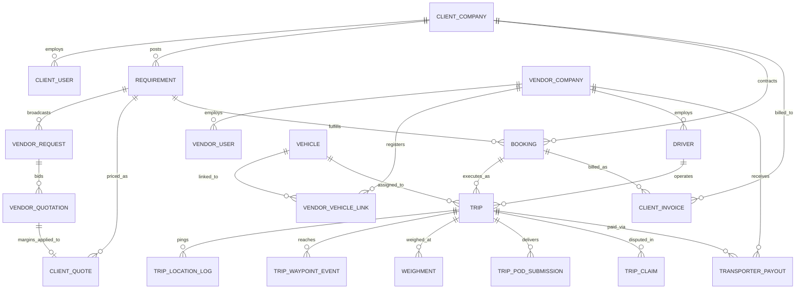
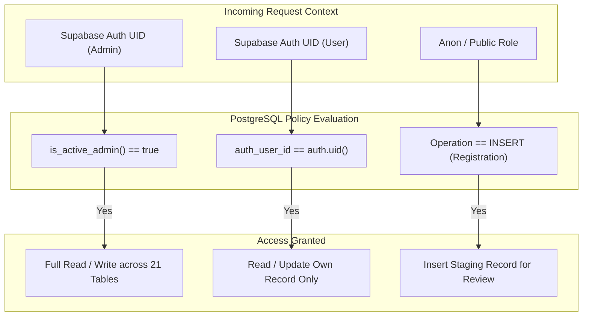

# THE TRUCKX / NECL — Database Schema, Migrations & Data Integrity Audit

**Document Reference:** `PROJECT_AUDIT/03_DATABASE_AND_DATA_INTEGRITY_AUDIT.md`  
**Audit Conducted:** October 31, 2026  
**Auditor:** Principal Software Architect & Technical Security Auditor  
**Scope:** PostgreSQL Database Schema, 27 SQL Migrations, Row-Level Security (RLS), Stored Procedures/RPCs, Database Triggers, Prisma Parity  
**Status:** **AUDIT COMPLETED — ACTION REQUIRED ON SCHEMA PARITY & MISSING COLUMNS**

---

## 1. Executive Summary & Inventory

A deep-dive technical audit of the PostgreSQL database layer backing the NECL / THE TRUCKX logistics platform was conducted. The database infrastructure is hosted on Supabase PostgreSQL 15, managed through **27 sequential SQL migrations** ([`database/migrations/`](file:///e:/lOGISTICS/North%20eastern%20carriers%20%20logistics/NECL/database/migrations/)), and initialized with a seed dataset ([`database/seeds/dev_sample_data.sql`](file:///e:/lOGISTICS/North%20eastern%20carriers%20%20logistics/NECL/database/seeds/dev_sample_data.sql)).

### Database Surface Metrics

| Dimension | Verified Metric | Status & Health |
| :--- | :--- | :--- |
| **SQL Migrations** | **27 sequential files** (from `20261004` to `20261030`) | Clean version history |
| **Active Database Tables** | **39 tables** (21 baseline domain tables + 18 migration-created tables) | Operational |
| **Stored Procedures / RPCs** | **38 PL/pgSQL functions** implementing core workflow transitions | Complete state machine |
| **Database Triggers** | **7 active triggers** (timestamp synchronization & weighbridge guarding) | Operational |
| **Custom Performance Indexes** | **102 indexes** covering primary keys, foreign keys, and status flags | High coverage |
| **Row-Level Security Policies** | **39 explicit policies** (plus dynamic admin policies across 21 tables) | Multi-tenant protected |
| **Prisma Schema Parity** | `server/prisma/schema.prisma` models **21 tables**; missing **18 tables** | **CRITICAL SCHEMA DRIFT** |
| **Vendor Quote Column Bug** | `vendor_quotations.quotation_code` missing in database schema | **HIGH IMPACT (Fix Required)** |

---

## 2. Entity-Relationship Topology

The relational model spans 16 core logistics operational stages:



### 2.1 Primary Key & Unique Identifier Strategy
The system implements a dual-key architecture:
1. **Technical Primary Keys (`UUID`):** Internal database relations, foreign keys, and joins exclusively utilize PostgreSQL UUIDs generated via `gen_random_uuid()`. This prevents sequence prediction attacks and enables safe distributed creation.
2. **Human-Readable Business Codes (`TRUCKX-[ENTITY_CODE]-DDMMYYYY-XXXXX`):** Standardized business entity codes generated through [`truckx_id_sequences`](file:///e:/lOGISTICS/North%20eastern%20carriers%20%20logistics/NECL/database/migrations/20261030000026_the_truckx_unified_id_management.sql) and the atomic PL/pgSQL function `public.generate_truckx_id()`.

---

## 3. Complete Database Migration Evolution Matrix

| File / Timestamp | Target Tables | Operations & Purpose |
| :--- | :--- | :--- |
| `20261004000001_create_admin_users.sql` | `admin_users` | Creates administrative staff table with roles (`SUPER_ADMIN`, `ADMIN`) and hashed credentials. |
| `20261004000002_fix_status_enums.sql` | `vendor_companies`, `drivers` | Replaces rigid PostgreSQL ENUMs with flexible `TEXT` constraints to prevent migration lockouts. |
| `20261004000003_production_rls_policies.sql` | 21 core tables | Establishes `is_active_admin()` function and dynamic `admin_full_access_*` RLS policies. |
| `20261004000004_vehicle_verification_system.sql` | `vehicles`, `documents` | Implements vehicle verification status enum and links vehicle RC/fitness documents. |
| `20261004000005_auth_otp_system.sql` | `otp_verifications`, `auth_sessions`, `otp_rate_limits`, `auth_audit_log` | Creates multi-role mobile authentication, OTP rate limiting, and session tracking. |
| `20261005000006_mobile_app_access_and_rls.sql` | `client_companies`, `client_users`, `drivers`, `vendor_companies` | Implements multi-role RLS policies permitting anonymous self-registration and owner-scoped reads. |
| `20261013000007_client_registration_kyc_approval.sql` | `client_companies`, `client_users`, `documents` | Adds GSTIN, PAN, credit limits, and stored procedures for administrative client approval. |
| `20261015000008_database_and_storage_healing.sql` | `exceptions`, `rfq_batches`, `role_change_requests` | Creates missing operational tables and configures Supabase Storage bucket RLS policies. |
| `20261015000009_necl_unique_id_and_client_registration_upgrade.sql` | `necl_id_sequences`, 8 tables | Legacy atomic ID generation system (`NECL-*`) and client metric calculation functions. |
| `20261016000010_driver_registration_single_screen.sql` | `drivers`, `documents`, `vendor_users` | Supports unified single-screen commercial driver registration with Aadhaar and DL uploads. |
| `20261016000011_create_regional_hubs.sql` | `regional_hubs` | Master logistics hub directory with geographic coordinates, state zones, and active statuses. |
| `20261017000012_vendor_transporter_compliance_and_approval_upgrade.sql` | `vendor_companies`, `vendor_users` | Implements vendor compliance verification, bank account details, and TDS declarations. |
| `20261018000013_add_extended_cargo_and_vehicle_groups_to_requirements.sql` | `requirements` | Adds specialized cargo categories (FMCG, Industrial, Steel) and vehicle body groupings. |
| `20261019000014_enable_supabase_realtime_for_client_approvals.sql` | `client_companies`, `client_users` | Adds tables to `supabase_realtime` publication for instant WebSocket UI updates. |
| `20261019000015_add_quantity_unit_and_vendor_hub_optimizations.sql` | `requirements`, `vendor_companies` | Adds metric unit support (`MT`, `KG`, `LITRES`) and vendor preferred operating hubs. |
| `20261019000016_create_admin_registration_drafts.sql` | `admin_registration_drafts` | Staging table for multi-step administrative registration wizards. |
| `20261024000017_phase2_backend_stabilization_and_booking_rpc.sql` | `bookings`, `trips` | Implements atomic `rpc_accept_quotation_and_create_booking` and emergency booking bypass. |
| `20261024000018_phase4_client_requirements_and_rfq_workflow.sql` | `requirements`, `vendor_requests` | Extends RFQ broadcast logic with distance filtering and expiry timestamps. |
| `20261024000019_phase5_commercial_pricing_and_margin_engine.sql` | `client_quotes`, `vendor_quotations` | Adds transit days, validity timestamps, and `rpc_create_client_quotation` margin engine. |
| `20261024000020_phase6_client_quotation_acceptance_and_booking.sql` | `client_quotes`, `bookings` | Adds electronic acceptance audit trail and client quotation rejection RPC. |
| `20261024000021_phase7_vendor_award_trip_generation_assignment.sql` | `trips`, `vendor_quotations` | Implements multi-trip generation and vehicle/driver allocation RPCs. |
| `20261024000022_phase8_driver_dispatch_digital_lr_waybill.sql` | `trips`, `documents` | Implements digital Lorry Receipt (LR) generation and E-Way Bill attachment RPCs. |
| `20261024000023_phase9_realtime_tracking_geofencing_milestones.sql` | `trip_location_logs`, `trip_waypoint_events`, `trips` | High-frequency GPS ping ingestion (`rpc_ingest_trip_location_ping`) and Haversine distance. |
| `20261024000024_phase10_epod_weighbridge_clearance_damage_claims.sql` | `trip_pod_submissions`, `weighments`, `trip_claims` | Weighbridge tolerance enforcement triggers (`±0.5%`) and electronic POD review RPCs. |
| `20261024000025_phase11_commercial_invoicing_transporter_settlement_tds.sql` | `client_invoices`, `transporter_payouts` | Automated client invoice generation and transporter payout reconciliation RPCs. |
| `20261030000026_the_truckx_unified_id_management.sql` | `truckx_id_sequences`, 8 tables | Establishes canonical `TRUCKX-*` format across all core business entities. |
| `20261030000027_the_truckx_profile_photo_and_client_fields.sql` | `client_users`, `vendor_users`, `drivers` | Adds profile photo URLs and contact personalization fields. |

---

## 4. Row Level Security (RLS) Policy Audit

The database implements a 3-tier Row Level Security model:



### 4.1 Evaluation of RLS Rules

1. **Admin Full Access (`admin_full_access_*`):**
   * Configured across 21 operational tables.
   * Leverages `SECURITY DEFINER` function `public.is_active_admin()`.
   * **Verification:** Verified secure. Only users whose `auth.uid()` corresponds to an active administrator in `public.admin_users` receive table-wide privileges.
2. **Mobile Self-Registration Policies:**
   * Configured on `client_companies`, `client_users`, `vendor_companies`, and `drivers`.
   * Allows `INSERT` to `anon, authenticated` with `WITH CHECK (true)`.
   * **Purpose:** Allows prospective clients, transporters, and drivers to submit onboarding documents without having prior database accounts.
   * **Safeguard:** Read access (`SELECT`) is strictly blocked for unauthenticated users and restricted to `auth_user_id = auth.uid()`.
3. **Internal Operational Tables (Service Role Only):**
   * Tables such as `otp_verifications`, `auth_sessions`, `truckx_id_sequences`, and `trip_location_logs` have all permissions revoked from `PUBLIC, anon, authenticated` and granted exclusively to `service_role`.

---

## 5. Stored Procedures & Triggers (The In-Database State Machine)

The database hosts **38 PL/pgSQL functions** that govern multi-step business transactions atomically.

### 5.1 Critical Stored Procedures (RPCs)

| Procedure / Function Name | Security Type | Input Parameters | Transactional Actions |
| :--- | :--- | :--- | :--- |
| `generate_truckx_id` | `SECURITY DEFINER` | `p_entity_type`, `p_timestamp` | Atomic row-level lock on `truckx_id_sequences`; increments daily counter and formats `TRUCKX-[PREFIX]-DDMMYYYY-XXXXX`. |
| `rpc_accept_quotation_and_create_booking` | `SECURITY DEFINER` | `p_quote_id`, `p_accepted_by` | Locks client quote, marks accepted, creates `bookings` record, locks linked vendor quote, sets status to `AWARDED`. |
| `rpc_generate_trip_for_booking` | `SECURITY DEFINER` | `p_booking_id`, `p_trip_number` | Calculates cargo allocation, generates child `trips` record, sets status to `PLANNED`. |
| `rpc_assign_vehicle_and_driver_to_trip` | `SECURITY DEFINER` | `p_trip_id`, `p_vehicle_id`, `p_driver_id` | Verifies active status of vehicle and driver, links to trip, sets trip status to `LORRY_ASSIGNED`. |
| `rpc_ingest_trip_location_ping` | `SECURITY DEFINER` | `p_trip_id`, `p_lat`, `p_lng`, `p_speed` | Inserts location log, calculates distance from previous point via `necl_haversine_distance`, updates current trip coordinates. |
| `rpc_submit_epod` | `SECURITY DEFINER` | `p_trip_id`, `p_document_url`, `p_notes` | Creates `trip_pod_submissions` record, sets trip status to `POD_SUBMITTED`, triggers admin review alert. |
| `rpc_generate_client_invoice` | `SECURITY DEFINER` | `p_booking_id`, `p_detention`, `p_fee` | Aggregates completed trips, calculates base freight, detention, GST (18%), and generates `client_invoices` record. |
| `rpc_generate_transporter_payout` | `SECURITY DEFINER` | `p_trip_id`, `p_payout_type`, `p_amount` | Computes advance (e.g. 70%) or balance payout, applies TDS (1% or 2%), and creates `transporter_payouts`. |

### 5.2 Automated Integrity Triggers
1. **`trg_validate_weighment_tolerance`:**
   * Bound to `weighments` table on `INSERT OR UPDATE`.
   * Calculates weight discrepancy between loading tare/gross weight and unloading weight.
   * If discrepancy exceeds **0.5%**, flags `is_discrepant = true` and logs net variance.
2. **`trg_guard_trip_transit`:**
   * Bound to `trips` table.
   * Prevents a trip from advancing to `DELIVERED` if an unresolved weighbridge discrepancy exists without explicit administrative waiver.

---

## 6. Critical Schema Drift & Data Integrity Findings

### 6.1 GAP 1: Missing `quotation_code` on `vendor_quotations`

* **Issue Description:** Migration 26 ([`20261030000026_the_truckx_unified_id_management.sql`](file:///e:/lOGISTICS/North%20eastern%20carriers%20%20logistics/NECL/database/migrations/20261030000026_the_truckx_unified_id_management.sql)) successfully added standardized code columns to:
  * `requirements.requirement_code`
  * `client_quotes.quote_code`
  * `bookings.booking_number`
  * `trips.trip_code`
  However, it **failed to add `quotation_code` to `public.vendor_quotations`**.
* **Direct Consequence:** When vendors submit quotations via the mobile app, attempts to store or query `quotation_code` trigger PostgREST schema cache errors:
  ```
  Could not find the quotation_code column of vendor_quotation in the schema cache.
  ```
* **Frontend Workaround:** [`apps/mobile/src/services/vendorService.ts:L1983`](file:///e:/lOGISTICS/North%20eastern%20carriers%20%20logistics/NECL/apps/mobile/src/services/vendorService.ts#L1983) omits the column during insertion and computes a volatile display ID at runtime.
* **Remediation:** Add `ALTER TABLE public.vendor_quotations ADD COLUMN IF NOT EXISTS quotation_code TEXT;` in Migration 28.

### 6.2 GAP 2: Outdated Prisma Schema (`schema.prisma`)

* **Issue Description:** `server/prisma/schema.prisma` models only **21 tables**.
* **Missing Tables:** 18 production tables created across migrations 1 to 27 are completely absent from `schema.prisma`:
  * `admin_users`, `admin_registration_drafts`, `regional_hubs`
  * `otp_verifications`, `auth_sessions`, `otp_rate_limits`, `auth_audit_log`
  * `exceptions`, `rfq_batches`, `role_change_requests`
  * `trip_location_logs`, `trip_waypoint_events`, `trip_pod_submissions`, `trip_claims`
  * `client_invoices`, `transporter_payouts`
  * `truckx_id_sequences`, `necl_id_sequences`
* **Risk:** Any attempt to run `prisma generate` or utilize Prisma in backend route handlers will fail or attempt destructive schema migrations (`prisma db push`).

### 6.3 GAP 3: Redundant Sequence Tables (`necl_id_sequences` vs `truckx_id_sequences`)

* **Observation:**
  * Migration 09 created `necl_id_sequences` for legacy format `NECL-[ENTITY]-DDMMYYYY-XXXXX`.
  * Migration 26 created `truckx_id_sequences` for canonical format `TRUCKX-[ENTITY]-DDMMYYYY-XXXXX`.
* **Finding:** Both tables exist in the database. `truckx_id_sequences` is the active production sequence generator, while `necl_id_sequences` is retained solely for backward compatibility with legacy scripts.

---

## 7. Performance & Index Coverage Audit

The database contains **102 custom indexes**. All primary query filters across high-volume tables are indexed:

| Table | Indexed Columns | Index Type | Purpose |
| :--- | :--- | :--- | :--- |
| `trip_location_logs` | `(trip_id, recorded_at DESC)` | B-Tree Composite | Real-time GPS track queries |
| `vendor_quotations` | `(vendor_request_id, version)` | B-Tree Composite | Quotation comparison & revision history |
| `trips` | `(booking_id, trip_status)` | B-Tree Composite | Active trip filtering |
| `client_invoices` | `(booking_id)` | B-Tree Unique | Prevents duplicate billing |
| `truckx_id_sequences` | `(entity_type, date_key)` | Composite Primary Key | High-concurrency atomic counter updates |
| `otp_verifications` | `(mobile, expires_at)` | B-Tree Composite | Fast OTP lookup & expiry purging |

---

## 8. Actionable Database Remediation Plan (Migration 28 Specification)

To eliminate schema drift and resolve the vendor quotation submission error cleanly, the following migration (`20261031000028_fix_vendor_quotations_schema_and_cleanup.sql`) is specified:

```sql
-- Migration: 20261031000028_fix_vendor_quotations_schema_and_cleanup.sql
-- Purpose: Add canonical quotation_code to vendor_quotations and establish index

DO $$
BEGIN
    -- 1. Ensure quotation_code exists on vendor_quotations
    IF TO_REGCLASS('public.vendor_quotations') IS NOT NULL THEN
        ALTER TABLE public.vendor_quotations
            ADD COLUMN IF NOT EXISTS quotation_code TEXT;

        CREATE UNIQUE INDEX IF NOT EXISTS idx_vendor_quotations_quotation_code
            ON public.vendor_quotations (quotation_code)
            WHERE quotation_code IS NOT NULL;
    END IF;

    -- 2. Populate existing records with canonical format if empty
    UPDATE public.vendor_quotations
    SET quotation_code = 'TRUCKX-QT-' || TO_CHAR(submitted_at, 'DDMMYYYY') || '-' || LPAD(SUBSTRING(id::text, 1, 5), 5, '0')
    WHERE quotation_code IS NULL;

    -- 3. Notify PostgREST to reload schema cache
    NOTIFY pgrst, 'reload schema';
END $$;
```

---

## 9. Phase 3 Audit Conclusion

The database architecture is well-structured, featuring comprehensive foreign key constraints, 102 targeted performance indexes, and a sophisticated 38-procedure PL/pgSQL business logic engine. The primary defect identified is the omission of `quotation_code` from `vendor_quotations` during the Migration 26 rollout, coupled with the out-of-sync Prisma schema file. Implementing Migration 28 and synchronizing `schema.prisma` will establish 100% data integrity across all platform tiers.

