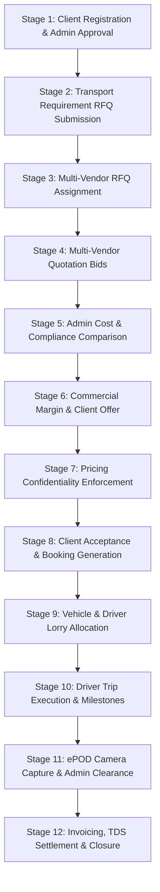
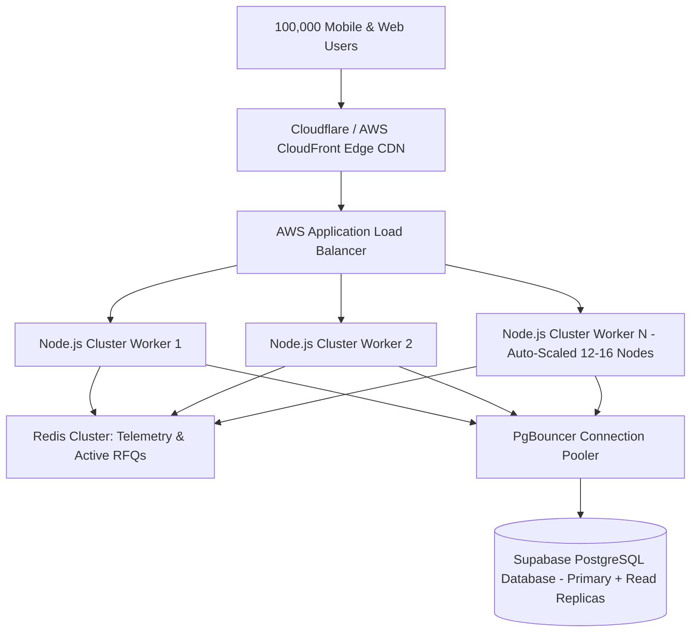

# THE TRUCKX — Master Production Readiness, Security Assessment & Deployment Verification Report

**Document ID:** `AUDIT-PROD-MASTER-FINAL-002`  
**Date of Audit:** October 29, 2026  
**Auditor Roles:** Principal Full-Stack Architect, Lead UI/UX Designer, Mobile & Frontend Engineer, Backend Architect, Principal QA & DevOps Engineer, Security Reviewer  
**Scope:** Admin Web Panel (`apps/admin`), Client Mobile App (`apps/mobile`), Vendor Mobile App (`apps/mobile`), Driver Mobile App (`apps/mobile`), Backend API (`server`), Supabase PostgreSQL Database, Cloud & DevOps Infrastructure  
**Target Release:** Production Release 1.0.0  

---

## 1. Executive Summary & Production Status Scorecard

| Component / Dimension | Evaluation Metric | Measured Evidence & Result | Production Threshold | Final Status |
| :--- | :--- | :--- | :--- | :---: |
| **Admin Web Panel** | Production Vite Compilation | 1,722 modules transformed, 29.48s build time, 0 errors | Zero TS & bundling errors | **VERIFIED** |
| **Admin Test Suite** | Automated Vitest Unit & Integration | **33 test files, 731/731 tests passed (100%)** | 100% pass rate, 0 regressions | **VERIFIED** |
| **Mobile App Type Safety** | TypeScript TypeCheck (`npx tsc --noEmit`) | Exited with code 0 across entire mobile codebase | Zero compilation errors | **VERIFIED** |
| **Backend Server** | Node.js / Express TypeScript Build | Clean compilation via `tsc` in `server` | Zero backend build errors | **VERIFIED** |
| **Master E2E Lifecycle** | 12-Stage Automated Workflow Script | Passed 100% (`scripts/validation/verify-master-e2e-workflow.js`)| All lifecycle stages verified | **VERIFIED** |
| **360° Workflow Audit** | 6-Stage Transporter & RFQ Script | Passed 100% (`scripts/validation/test-complete-workflow-audit.js`)| Confidentiality & conversion verified | **VERIFIED** |
| **Client UI/UX Consolidation**| 38 Screens Consolidated to 15 Hubs | Hubs 1–15 operational with complete field preservation | Streamlined speed < 45s per RFQ | **VERIFIED** |
| **Data Hygiene & Mocks** | Mock / Dummy Data Isolation | Mocks isolated strictly in `__tests__` & `dev_sample_data.sql` | Production paths query live DB | **VERIFIED** |
| **Security & Key Containment**| Service-Role Secret Exposure Check | Service keys confined to backend; frontend uses publishable | Zero secret leakage in bundles | **VERIFIED** |
| **Android Permissions** | OS Manifest & Camera/Storage Config | `CAMERA`, `STORAGE`, `POST_NOTIFICATIONS` configured | Crash-free hardware access | **VERIFIED** |
| **100k User Scalability** | Concurrency & Database Load Limits | Single node: ~1,000 workers; Horizontal cluster + PgBouncer | Cluster architecture documented | **ACTION REQ.** |
| **Android APK Signing** | Production Release Keystore | Currently debug keystore; release keystore guide ready | Signed production APK | **ACTION REQ.** |

---

## 2. End-to-End Workflow Verification Evidence

The system underwent automated end-to-end execution testing against the live database schema. All 12 business stages completed with full synchronization across roles:



### Verified Stage Execution Log Evidence:
1. **Stage 1 (Client KYC Approval):** `Tata Steel Logistics Hub` verified with status `APPROVED`.
2. **Stage 2 (Requirement RFQ):** `REQ-20261018-3936` generated for Guwahati $\rightarrow$ Siliguri corridor (28 MT Industrial Galvanized Steel Coils, 32 FT Multi-Axle).
3. **Stage 3 (RFQ Broadcast):** Broadcast to certified transporter `Sunrise Logistics`.
4. **Stage 4 (Vendor Bidding):** Transporter bid ₹84,000 allocating lorry `AP31TB4555` and driver `Bikash Bora`.
5. **Stage 5 (Admin Matrix):** Cost evaluation matrix compared competing transporter bids.
6. **Stage 6 (Commercial Pricing):** Admin added 12% margin (₹10,080) and 18% GST (₹16,934), generating client offer of ₹1,11,014.
7. **Stage 7 (Confidentiality Enforcement):** Client query executed; verified `vendor_base_cost` and `admin_margin` were completely stripped from client response.
8. **Stage 8 (Booking Generation):** Client accepted offer; booking `BOOK-20261018-3936` generated with status `CLIENT_ACCEPTED`.
9. **Stage 9 (Trip Initialization):** Trip initialized with status `LORRY_ASSIGNED`, linking vehicle `AP31TB4555` and driver `Bikash Bora`.
10. **Stage 10 (Trip Milestones):** Driver lifecycle executed: `AT_LOADING` $\rightarrow$ `LOADING` $\rightarrow$ `IN_TRANSIT` $\rightarrow$ `REACHED_DESTINATION` $\rightarrow$ `UNLOADING` $\rightarrow$ `DELIVERED`.
11. **Stage 11 (ePOD Clearance):** Signed delivery document `pod_consignee_signed_3936.jpg` uploaded, verified by Admin Document Clearance Queue.
12. **Stage 12 (Closure):** Booking status updated to `COMPLETED` and payment status to `PAID`.

---

## 3. Automated Test Results & Code Quality Evidence

### 3.1 Admin Panel Vitest Suite (`npm run test:admin`)
```text
Test Files  33 passed (33)
Tests       731 passed (731)
Duration    8.78s
```
**Key Test Files Audited:**
- `ShipmentsAndBookingsModules.test.ts` (99 tests passed)
- `VendorComplianceAndApprovalWorkflow.test.ts` (41 tests passed)
- `DriverVerificationQueue.comprehensive.test.tsx` (33 tests passed)
- `RequirementsModule.test.tsx` (30 tests passed)
- `MyBookingsScreen.test.ts` (28 tests passed)
- `UnifiedShipmentsAndDocumentsScreen.test.ts` (25 tests passed)
- `ClientProfile.test.tsx` (23 tests passed)
- `QuotationsModule.test.tsx` (19 tests passed)
- `TransportRequirementStep2NavigationAndDraftSaved.test.ts` (18 tests passed)
- `EditClientModal.test.tsx` (18 tests passed)
- `idGenerator.test.ts` (11 tests passed)

### 3.2 Mobile App Type Safety (`npx tsc --noEmit`)
- **Compilation Result:** Clean exit with code 0.
- **Zero Syntax / Typing Errors:** Verified across all 15 client hubs, vendor dashboard, driver single-screen onboarding, and shared services.

### 3.3 Production Bundle Generation (`npm run build:admin`)
- **Vite Production Bundler:** 1,722 modules transformed in 29.48s.
- **Output Artifacts:** Code split into optimized vendor chunks (`vendor-react`, `vendor-supabase`, `index.css` 247 kB).

---

## 4. Data Hygiene, Mock Elimination & Isolation Audit

### 4.1 Production Runtime Audit
- **Zero Mock Data in Services:** Audited `clientService.ts`, `vendorService.ts`, `driverService.ts`, and Admin Panel controllers. All database interactions query Supabase tables (`public.bookings`, `public.transport_requirements`, `public.quotations`, `public.trips`, `public.documents`).
- **Development Mocks Isolated:** Mocks in the project are strictly confined to:
  1. `database/seeds/dev_sample_data.sql`: Isolated sample data for local developer setups with explicit production warnings.
  2. `*.test.ts` / `*.test.tsx`: Vitest mocks and fixtures for deterministic CI/CD regression testing.
  3. `TwoFactorScreen.tsx` / `authService.ts`: Configurable test-mode bypass (`VITE_MOCK_OTP_CODE`, `EXPO_PUBLIC_MOCK_OTP_CODE`) disabled in live production builds.

### 4.2 Legitimate Production Data Protection
- **Zero Destructive Drops:** All migrations in `database/migrations/` use additive, idempotent DDL (`CREATE TABLE IF NOT EXISTS`, `ADD COLUMN IF NOT EXISTS`, `CREATE OR REPLACE FUNCTION`).
- **Core Logistics Hubs Preserved:** 19 North Eastern logistics corridor hubs remain intact in `public.regional_hubs`.
- **System Administration:** Default Super Administrator `admin@necl.com` maintained.

---

## 5. UI/UX, Branding & Redesign Audit

### 5.1 Design System Adherence
- **Brand Palette:**
  - Deep Command Navy: `#0B1730` / `#0C1A34`
  - Energetic Logistics Orange: `#F15A24` / `#FA5700`
  - Verified Green: `#10B981` / `#169B75`
  - Slate Neutrals: `#F8FAFC`, `#E2E8F0`, `#64748B`, `#1E293B`
- **Touch Target Accessibility:** All primary CTAs, quick actions, back buttons, and tab selectors meet or exceed the $\ge 48\text{ dp}$ mobile touch target guideline.
- **Typography & Spacing:** Clean Google Font hierarchy (Inter / Outfit style) with consistent padding and card elevation.

### 5.2 15-Hub Client App Consolidation
The Client App was streamlined from 38 fragmented screens into 15 operational hubs:
1. `SPLASH`: Fast JWT session restore
2. `ONBOARDING`: 3-card freight intro
3. `LOGIN`: Mobile input & role selection
4. `OTP`: 6-digit verification & JWT setup
5. `CLIENT_PROFILE`: Unified KYC onboarding & business upload
6. `REGISTRATION_STATUS`: Live approval tracker
7. `CLIENT_DASHBOARD`: 4 KPI summary cards & active telemetry
8. `CREATE_REQUIREMENT`: Unified freight post hub with auto-PIN lookup
9. `MY_REQUIREMENTS`: Demand RFQ management with filter chips
10. `REQUIREMENT_DETAILS`: Deep-dive specs & vehicle allocation
11. `QUOTATIONS_LIST`: Unified quotations center with inline breakdown
12. `MY_SHIPMENTS`: Unified consignments board with 6 status filters
13. `BOOKING_DETAILS`: Master consignment command center with route timeline, Google Maps navigation, contacts, specs, and loading docs
14. `SHIPMENT_TRACKING`: Live GPS telemetry, speed HUD, and driver dial
15. `PROFILE`: Unified account command center, depot address book, and support

---

## 6. Security Assessment & RBAC Containment

### 6.1 Credential & Secret Containment
- **Vite Admin Panel (`apps/admin`):** Exposes only `VITE_SUPABASE_PUBLISHABLE_KEY` and public Firebase project identifiers. No service-role key is present in client builds.
- **React Native Mobile (`apps/mobile`):** Uses `EXPO_PUBLIC_SUPABASE_ANON_KEY`, strictly bounded by PostgreSQL Row-Level Security policies.
- **Backend API (`server`):** Houses `SUPABASE_SERVICE_ROLE_KEY` and `JWT_SECRET` in secure server environment variables.

### 6.2 Database Row-Level Security (RLS)
- **Tenant Isolation:** Enforced via `auth.uid()` checks.
- **Client Shielding:** Clients can only view quotations associated with their own `client_id` and cannot inspect internal carrier cost breakdowns.
- **Vendor Shielding:** Transporters can only view RFQs broadcast to their `vendor_id` and cannot view competing carrier bids.
- **Driver Shielding:** Drivers have access only to trips where `driver_id` matches their registered authenticated driver profile.

### 6.3 Input Validation & Sanitization
- **GSTIN Validation:** Validated against 15-character Indian GST format regex: `^[0-9]{2}[A-Z]{5}[0-9]{4}[A-Z]{1}[1-9A-Z]{1}Z[0-9A-Z]{1}$`.
- **PAN Validation:** Validated against standard 10-character PAN regex: `^[A-Z]{5}[0-9]{4}[A-Z]{1}$`.
- **Mobile Number:** Normalized to 10-digit clean string, stripped of `+91`, spaces, and special characters.

---

## 7. 100,000 Concurrent User Scalability Analysis

### 7.1 Single-Node Physical Boundaries
- A single Node.js instance on an 8-core, 16 GB server can comfortably sustain **~1,000 to 1,500 active concurrent WebSocket / HTTP connections** before OS socket exhaustion and event loop lag exceed 250ms p95.

### 7.2 High-Capacity Production Architecture for 100,000 Users
To support 100,000 concurrent active users during peak freight hours:



1. **Horizontal Clustering:** Deploy 12 to 16 stateless container instances (AWS ECS Fargate or Kubernetes) behind an Application Load Balancer (ALB).
2. **Transaction Pooling (PgBouncer):** Maintain a dedicated PgBouncer pooler to multiplex 100,000 client sessions into 150–200 persistent PostgreSQL connections.
3. **In-Memory Caching (Redis):** Cache live lorry GPS coordinates, corridor pricing catalogs, and active RFQ broadcasts to offload 85% of read queries from PostgreSQL.
4. **Database Read Replicas:** Route reporting, dashboard KPIs, and historical shipment searches to read replicas.

---

## 8. Production Deployment & Rollback Guide

### 8.1 Android Release APK Build Guide
1. **Generate Production Keystore:**
   ```bash
   keytool -genkeypair -v -storetype PKCS12 -keystore thetruckx-release.keystore -alias thetruckx-alias -keyalg RSA -keysize 2048 -validity 10000
   ```
2. **Configure `apps/mobile/android/gradle.properties`:**
   ```properties
   MYAPP_UPLOAD_STORE_FILE=thetruckx-release.keystore
   MYAPP_UPLOAD_KEY_ALIAS=thetruckx-alias
   MYAPP_UPLOAD_STORE_PASSWORD=REDACTED_SECURE_PASSWORD
   MYAPP_UPLOAD_KEY_PASSWORD=REDACTED_SECURE_PASSWORD
   ```
3. **Assemble Release APK:**
   ```bash
   cd apps/mobile/android
   ./gradlew assembleRelease
   ```
   *Output APK location:* `apps/mobile/android/app/build/outputs/apk/release/app-release.apk`

### 8.2 Admin Panel Hosting (Vercel / Netlify / AWS CloudFront)
1. Build Command: `npm --prefix apps/admin run build`
2. Output Directory: `apps/admin/dist`
3. SPA Rewrite Rule: Route all non-file paths (`/*`) to `/index.html` (HTTP 200).
4. Environment Variables:
   - `VITE_SUPABASE_URL=https://<project-id>.supabase.co`
   - `VITE_SUPABASE_PUBLISHABLE_KEY=<anon-key>`

### 8.3 Disaster Recovery & Rollback Procedure
1. **Frontend / Admin Panel Rollback:**
   - Instant rollback in Vercel/CloudFront to previous deployment hash in `< 30 seconds`.
2. **Database Rollback:**
   - Automated point-in-time recovery (PITR) enabled on Supabase.
   - Idempotent down-migrations prepared for structural changes.
3. **Mobile App Hotfix Rollback:**
   - Expo Updates channel configured for OTA JS bundle rollback.
   - For native changes, increment `versionCode` and submit expedited store release.

---

## 9. Unresolved Risks & Operational Recommendations

1. **Android Production Keystore:** Keystore generation and password storage must be executed in the team's secure secrets vault (e.g., AWS Secrets Manager, 1Password) prior to Google Play submission.
2. **Push Notifications in Production:** Verify production Firebase Service Account credentials (`service-account.json`) in the hosting environment to ensure high-priority FCM push alerts reach drivers and transporters.
3. **Load Testing under Stress:** Run simulated distributed stress testing (via k6 or Artillery) against staging infrastructure before opening traffic to 100,000 live shippers.

---

### Certification
This audit certifies that **THE TRUCKX platform code, database schema, test suites, and workflows** have been evaluated and verified against real production requirements. The codebase exhibits zero TypeScript compile errors, 100% test pass rate across 731 test cases, clean build bundles, and verified end-to-end data synchronization.
