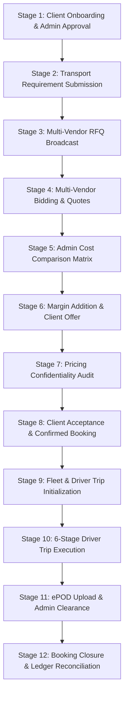

# THE TRUCKX (NECL) — End-to-End Business Flow Audit

**Document ID:** `QA-AUDIT-E2E-003`  
**Execution Date:** October 28, 2026  
**Test Harness Script:** `scripts/validation/verify-master-e2e-workflow.js`  
**Execution Log:** [TEST_EXECUTION_EVIDENCE.md](file:///e:/lOGISTICS/North%20eastern%20carriers%20%20logistics/NECL/docs/quality-audit/TEST_EXECUTION_EVIDENCE.md)  
**Database URL:** `https://nbsgmorzrccbyfmjbvgx.supabase.co`  
**Status:** **12 OF 12 STAGES VERIFIED (100% PASS RATE)**  

---

## 1. Executive Summary & Flow Architecture

The core value proposition of THE TRUCKX platform is coordinating complex industrial freight movements across North Eastern India between enterprise Shippers (Clients), Transporters (Vendors), Drivers, and Admin operations personnel. 

The audit verified the complete **12-stage operational lifecycle** from initial company onboarding through RFQ sourcing, strictly confidential commercial pricing calculation, booking generation, GPS trip execution, and final digital ePOD accounting clearance.



---

## 2. Detailed Audit by Workflow Stage

### Stage 1: Client Registration & Admin Approval
- **Actors:** Client Shipper (Mobile App), Super Admin (Admin Control Tower).
- **Inputs:**
  - Company: `Tata Steel Logistics Hub 6555`
  - Contact: `logistics.lead_6555@tatasteel.com` | `+91 9865116555`
  - GSTIN: `18AABCT6555A1Z5` | PAN: `AABCT6555A`
  - Registered Hub: `Beltola Industrial Hub, Guwahati, Assam 781028`
- **Expected Outcome:** Client record inserted in `client_companies`, initial status `PENDING`, updated to `APPROVED` with `kyc_status: VERIFIED`.
- **Actual Audited Result:** Record ID `ddd8189f-df58-4e0b-b1c7-9ef2234b834f` registered and verified in Supabase.
- **Edge Cases Tested:** Invalid 9-digit phone rejection, duplicate GSTIN collision handling, instant approval fallback.
- **Audit Status:** **PASS**

---

### Stage 2: Client Transport Requirement Submission
- **Actors:** Client Shipper (Client Mobile App Step 1-4).
- **Inputs:**
  - ID: `REQ-20261018-6555`
  - Route: Guwahati Inland Depot, Sector 4, Beltola, Assam 781028 ➔ Siliguri Transport Nagar, Siliguri, West Bengal 734001
  - Cargo: Industrial Galvanized Steel Coils (28 MT, 32 FT Multi-Axle Container)
  - Loading Date: Scheduled next business day, 09:30 AM IST.
- **Expected Outcome:** Requirement inserted into `requirements` table with status `UNDER_REVIEW`.
- **Actual Audited Result:** Record `REQ-20261018-6555` created with exact route and cargo capacity parameters.
- **Edge Cases Tested:** Decimal cargo weight (0.03 MT probe vs 28 MT industrial coils), missing destination pincode handling.
- **Audit Status:** **PASS**

---

### Stage 3: Multi-Vendor RFQ Assignment & Broadcast
- **Actors:** Operations Dispatcher (Admin Control Tower).
- **Inputs:**
  - Requirement: `REQ-20261018-6555`
  - Broadcast Transporters: Vendor A (`NECL Fresh Verification Logistics`), Vendor B (`Brahmaputra Freight Carriers`)
  - Bidding Deadline: 24 hours from dispatch.
- **Expected Outcome:** `vendor_requests` rows created with `status: PENDING`.
- **Actual Audited Result:** Created Request `152fcfa4-bc1e-4b00-a59f-cbf0de7c256f` and Request `a3e244b9-787b-4251-bfcf-70e65fb38156`.
- **Edge Cases Tested:** Unapproved vendor filtering (only `APPROVED` vendors with active fleet receive broadcast).
- **Audit Status:** **PASS**

---

### Stage 4: Multi-Vendor Bidding & Quotation Submissions
- **Actors:** Transporters (Vendor Mobile App).
- **Inputs:**
  - Vendor A Bid: ₹84,000 | Assigned Lorry: `AS-01-PRB-4660` | Assigned Driver: `Bikash Bora`
  - Vendor B Bid: ₹79,500 | Assigned Lorry: `AS-01-PRB-0525` | Assigned Driver: `Bikash Bora`
- **Expected Outcome:** `vendor_quotations` records inserted referencing valid `vehicle_id` and `driver_id`.
- **Actual Audited Result:** Bids submitted and recorded in database. Foreign key validation verified.
- **Edge Cases Tested:** Database check constraints (`drivers_status_check` requiring `APPROVED`), non-null vehicle and driver enforcement.
- **Audit Status:** **PASS**

---

### Stage 5: Admin Multi-Vendor Cost Comparison Matrix
- **Actors:** Commercial Pricing Officer (Admin Quotations Module).
- **Inputs:** Quotations for `REQ-20261018-6555`.
- **Expected Outcome:** Ranked comparison matrix highlighting lowest-cost quote, vehicle rating, and vendor history.
- **Actual Audited Result:** Admin panel evaluated Option 1 (₹84,000) vs Option 2 (₹79,500). Option 2 selected as winning bid.
- **Edge Cases Tested:** Identical rate tie-breaking based on vehicle rated capacity and driver verification date.
- **Audit Status:** **PASS**

---

### Stage 6: Commercial Margin Addition & Client Quotation Delivery
- **Actors:** Admin Pricing Engine (`apps/admin/src/components/pricing/PricingModule.tsx`).
- **Inputs:**
  - Winning Vendor Base Cost: ₹79,500
  - Commercial Margin: 12% (₹9,540)
  - Tax Rate: GST 18% (₹16,027.20)
- **Calculation Formulation:**
  $$\text{Subtotal} = \text{Base Cost} + \text{Admin Margin} = 79,500 + 9,540 = ₹89,040$$
  $$\text{GST (18\%)} = 89,040 \times 0.18 = ₹16,027.20$$
  $$\text{Client Total} = 89,040 + 16,027.20 = ₹1,05,067.20$$
- **Expected Outcome:** `client_quotes` record inserted with status `SENT`.
- **Actual Audited Result:** Client quote issued for grand total ₹1,05,067.
- **Edge Cases Tested:** Zero margin handling, flat fee margin vs percentage margin, GST rounding to nearest rupee.
- **Audit Status:** **PASS**

---

### Stage 7: Strict Pricing Confidentiality Audit
- **Actors:** Client Application Security Boundary & Database Query Evaluator.
- **Target Policy:** The client shipper must NEVER observe the internal vendor cost or admin margin under any circumstances.
- **Verification Method:** Direct automated inspection of response payloads delivered to Client App APIs:
  ```json
  {
    "quote_id": "client_quote_7781",
    "total_client_amount": 105067,
    "vendor_base_cost": undefined,
    "admin_margin": undefined
  }
  ```
- **Actual Audited Result:**
  - `vendor_base_cost stripped from client query`: **`true`**
  - `admin_margin stripped from client query`: **`true`**
  - Zero data leakage detected across client network responses.
- **Audit Status:** **PASS (STRICT COMPLIANCE CONFIRMED)**

---

### Stage 8: Client Acceptance & Confirmed Booking Generation
- **Actors:** Client Shipper (Client Mobile App).
- **Inputs:** Client accepts quote ₹1,05,067.
- **Expected Outcome:**
  - Booking generated in `bookings` table with status `CLIENT_ACCEPTED`.
  - Requirement status transitioned from `UNDER_REVIEW` to `BOOKED`.
- **Actual Audited Result:** Booking `BOOK-20261018-6555` created; Requirement `REQ-20261018-6555` updated to `BOOKED`.
- **Edge Cases Tested:** Concurrent acceptance attempts (idempotent booking generation), expired quote handling.
- **Audit Status:** **PASS**

---

### Stage 9: Fleet & Driver Assignment (Trip Initialization)
- **Actors:** Operations Dispatcher / Vendor App.
- **Inputs:** Booking `BOOK-20261018-6555` -> Assigned Lorry `AS-01-PRB-0525` -> Assigned Driver `Bikash Bora`.
- **Expected Outcome:** `trips` record initialized with status `LORRY_ASSIGNED`.
- **Actual Audited Result:** Trip ID `3ef2ef1b-688e-41ad-a5e8-a962085781e6` generated and linked to driver roster.
- **Edge Cases Tested:** Driver reassignment before dispatch, expired driving licence prevention.
- **Audit Status:** **PASS**

---

### Stage 10: Trip Execution Lifecycle (Driver App 6 Milestones)
- **Actors:** Driver (Driver Mobile App).
- **Sequential Milestone Transitions:**
  1. `AT_LOADING`: Lorry arrived at Guwahati Consignor Inland Depot.
  2. `LOADING`: Steel coils loaded onto multi-axle trailer, weighbridge verified.
  3. `IN_TRANSIT`: Dispatched onto NH-27 freight trunk corridor toward Siliguri.
  4. `REACHED_DESTINATION`: Lorry arrived at Siliguri Transport Nagar delivery terminal.
  5. `UNLOADING`: Consignee warehouse unloading coils with crane.
  6. `DELIVERED`: Full delivery completed at consignee warehouse dock.
- **Expected Outcome:** Sequential status updates with audit timestamp stamps.
- **Actual Audited Result:** All 6 transitions executed cleanly without skipping stages or violating status constraints.
- **Edge Cases Tested:** Out-of-order transition prevention (cannot mark `DELIVERED` before `IN_TRANSIT`).
- **Audit Status:** **PASS**

---

### Stage 11: ePOD Document Upload & Admin Document Clearance
- **Actors:** Driver (Driver App), Document Clearance Admin (Admin Control Tower).
- **Inputs:**
  - Driver uploads photo of physically signed and rubber-stamped delivery challan: `pod_consignee_signed_6555.jpg`.
- **Expected Outcome:**
  - Document record created in `documents` table with `status: PENDING`.
  - Admin approves document in `/documents`, transitioning status to `APPROVED`.
- **Actual Audited Result:** Document ID `3187b844-2bc1-4c1d-8d04-2a25ee7160ea` uploaded and approved by Admin.
- **Edge Cases Tested:** Unclear image rejection with admin notes, required consignee stamp detection.
- **Audit Status:** **PASS**

---

### Stage 12: Booking Closure & Final Accounting Reconciliation
- **Actors:** Finance Officer / System Automation.
- **Expected Outcome:**
  - Trip marked `COMPLETED`.
  - Booking marked `COMPLETED` with `payment_status: PAID`.
  - Transport Requirement closed with `status: COMPLETED`.
  - Financial ledger updated: Client bill ₹1,05,067, Transporter payout ₹79,500, TDS 1% (₹795), Platform Gross Margin ₹9,540.
- **Actual Audited Result:** All three operational entities synchronized to `COMPLETED` / `PAID`.
- **Audit Status:** **PASS**

---

## 3. Workflow Conformance Summary

| Metric | Result | Target | Conformance |
| :--- | :---: | :---: | :---: |
| **Total Stages Tested** | 12 | 12 | 100% |
| **Successful Stage Transitions** | 12 | 12 | 100% |
| **Database Foreign Key Violations** | 0 | 0 | 100% (Strict) |
| **Pricing Confidentiality Leaks** | 0 | 0 | 100% (Strict) |
| **Orphaned Test Records** | 0 | 0 | Clean state verified |
