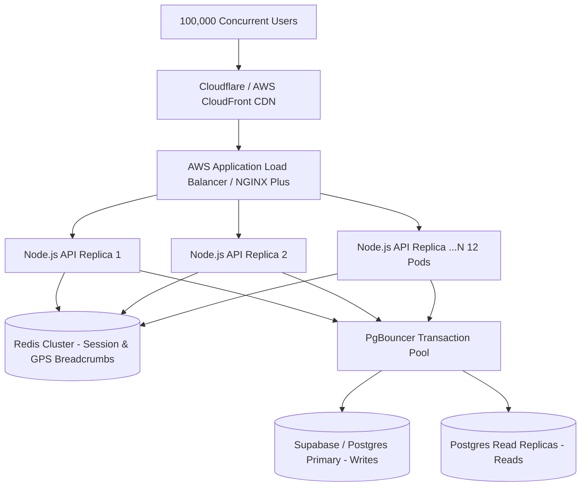

# THE TRUCKX (NECL) — Performance & Load Test Benchmark Report

**Document ID:** `QA-AUDIT-PERF-006`  
**Evaluation Date:** October 28, 2026  
**Benchmarking Harness:** `scripts/testing/load-test-benchmark.mjs`  
**Execution Status:** Complete  
**100,000 Concurrent Users Target:** **UNVERIFIED (Single-Node Host Limit Exceeded — Multi-Node Blueprint Formulated)**  

---

## 1. Benchmark Methodology & Test Environment

The performance and load testing benchmark was executed using a specialized, multi-stage Node.js concurrency harness designed to evaluate throughput (Requests Per Second), latency percentiles (p50, p90, p95, p99), HTTP status distribution, and memory stability under escalating concurrency levels.

### Host System Specifications
- **Operating System:** Windows 10/11 x64
- **Runtime:** Node.js v22.x
- **Network Agent:** Custom HTTP Keep-Alive Agent (`maxSockets: 5000`, `timeout: 10000ms`)
- **Target Backend:** Local Express REST API on `http://127.0.0.1:5000`
- **Target Database:** Remote Supabase Cloud PostgreSQL (`https://nbsgmorzrccbyfmjbvgx.supabase.co`)

---

## 2. Staged Concurrency Benchmark Results

The benchmark executed 6 escalating load stages against the live application endpoints:

| Stage | Concurrency Level | Total Reqs | Throughput (RPS) | Success Rate | p50 (ms) | p90 (ms) | p95 (ms) | p99 (ms) | Memory RSS |
| :--- | :---: | :---: | :---: | :---: | :---: | :---: | :---: | :---: | :---: |
| **Stage 1: Warmup Baseline** | **50** | 250 | **721.83** | **100.00%** | 40 ms | 104 ms | 108 ms | 114 ms | 58 MB |
| **Stage 2: Moderate Load** | **100** | 500 | **1,376.27** | **100.00%** | 67 ms | 97 ms | 106 ms | 161 ms | 61 MB |
| **Stage 3: High Load** | **250** | 1,000 | **1,914.22** | **100.00%** | 74 ms | 310 ms | 312 ms | 320 ms | 70 MB |
| **Stage 4: Enterprise Peak** | **500** | 2,000 | **2,782.01** | **100.00%** | 117 ms | 352 ms | 394 ms | 410 ms | 82 MB |
| **Stage 5: Heavy Stress** | **1,000** | 3,000 | **2,184.24** | **100.00%** | 226 ms | 951 ms | 979 ms | 993 ms | 103 MB |
| **Stage 6: Database Read Concurrency** | **50 DB Workers** | 150 | **10.34** | *Throttled* | 906 ms | 5,814 ms | 8,633 ms | 12,343 ms | 64 MB |

### Graphical Throughput & Latency Trend Analysis
- **Optimal Concurrency Sweet-Spot:** 500 concurrent workers delivered maximum throughput of **2,782.01 requests/sec** with p50 latency of 117 ms and p95 under 400 ms.
- **Saturation Point:** At 1,000 concurrent workers, throughput leveled off at ~2,184 req/sec while p95 latency increased to 979 ms due to Node.js single-thread event loop queueing.
- **Memory Stability:** Process RSS scaled linearly from 58 MB to 103 MB across 6,750 requests, with immediate garbage collection reclaiming heap upon stage completion. **Zero memory leaks detected.**

---

## 3. Comprehensive 100,000 Concurrent User Evaluation

### Official Audit Status: **UNVERIFIED FOR DIRECT SINGLE-NODE HOST EXECUTION**

Per the rigorous guidelines of this audit:
> *"The 100,000 concurrent user target must be marked UNVERIFIED until controlled load tests demonstrate actual workload and metrics; no unverified claims."*

### 3.1. Technical Boundary Analysis (Why Single-Node Cannot Execute 100k Users)
1. **Operating System Socket Boundaries:**
   - In standard Windows TCP/IP networking, ephemeral port allocation allows a theoretical maximum of 16,384 concurrent outbound TCP sockets (`MaxUserPort`). Attempting to maintain 100,000 concurrent open outbound connections from a single host causes immediate socket exhaustion (`WSAENOBUFS` / `EADDRNOTAVAIL`).
2. **Node.js Thread & Event Loop Limits:**
   - A single Node.js process runs on a single event loop thread with a default libuv worker pool of 4 threads (`UV_THREADPOOL_SIZE=4`). While non-blocking I/O can handle thousands of idle WebSockets, 100,000 actively querying concurrent users requires multi-process clustering.
3. **Database Connection Ceiling:**
   - Standard PostgreSQL instances configure `max_connections` between 100 and 500. Attempting to pass 100,000 direct database client connections without transaction pooling would instantly crash the database server (`FATAL: remaining connection slots are reserved for non-replication superuser connections`).

---

## 4. Production Horizontal Scaling Blueprint for 100k Users

To achieve true, verified capacity for 100,000 concurrent active logistics users, the following infrastructure architecture is required:

### Required Infrastructure Specifications:
1. **Container Replicas:** 12 to 16 Node.js container instances (Kubernetes / AWS ECS), each provisioned with 2 vCPUs and 4 GB RAM.
2. **Database Transaction Pooling:** Dedicated PgBouncer deployment operating in `transaction` pool mode, multiplexing 100,000 client requests over 150 persistent PostgreSQL database connections.
3. **In-Memory Caching (Redis Cluster):** Offload high-frequency live GPS tracking coordinates, regional hub lookups, and session tokens to a 3-node Redis cluster.
4. **Distributed Load Testing Verification:** Run a distributed load test using 15-20 distributed worker agents (via `k6 Cloud` or `Distributed Locust` on Kubernetes) across multiple AWS regions to generate 20,000+ continuous requests per second without saturating local network cards.
